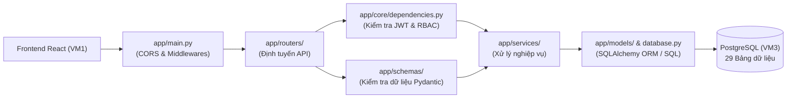

# TÀI LIỆU KIẾN TRÚC & CẤU TRÚC BACKEND (CVIEW API)

## 1. Tổng quan
Backend của dự án **CView** được xây dựng bằng **Python / FastAPI** theo kiến trúc phân tầng (**Layered Architecture**), đảm bảo tách biệt rõ ràng giữa định tuyến API (`routers`), kiểm tra dữ liệu (`schemas`), xử lý nghiệp vụ (`services`) và tương tác cơ sở dữ liệu PostgreSQL (`models`).

- **Framework chính:** FastAPI + Uvicorn
- **ORM & Database:** SQLAlchemy 2.0 + Psycopg2 + Alembic (kết nối tới PostgreSQL trên **VM3**)
- **Bảo mật & Phân quyền:** Bcrypt (mã hóa mật khẩu), JWT (xác thực phiên) và RBAC (phân quyền 3 vai trò: `CANDIDATE`, `RECRUITER`, `ADMIN`)
- **Xử lý CV PDF:** `pdfplumber` (trích xuất văn bản và bóc tách kỹ năng từ CV $\le 10\text{MB}$)

---

## 2. Sơ đồ Cấu trúc Thư mục `backend/`

```text
backend/
├── .env.example                     # Mẫu cấu hình biến môi trường (Database, JWT, CORS, Upload)
├── requirements.txt                 # Danh sách các thư viện Python cần cài đặt
├── app/
│   ├── __init__.py
│   ├── main.py                      # Điểm khởi chạy ứng dụng FastAPI, cấu hình CORS & gắn các Routers
│   │
│   ├── core/                        # TẦNG CẤU HÌNH LÕI & BẢO MẬT
│   │   ├── config.py                # Đọc biến môi trường từ file .env (Settings)
│   │   ├── database.py              # Khởi tạo kết nối PostgreSQL (engine, SessionLocal, Base, get_db)
│   │   ├── security.py              # Hàm băm mật khẩu (bcrypt), tạo JWT Access Token & Refresh Token
│   │   └── dependencies.py          # Kiểm tra đăng nhập (JWT) và phân quyền theo vai trò (RBAC)
│   │
│   ├── middlewares/                 # TẦNG TRUNG GIAN (LOGGING & ERROR TRACKING)
│   │   └── __init__.py              # Tự động ghi nhận hành vi (activity_logs) & lỗi (system_error_logs)
│   │
│   ├── models/                      # TẦNG DỮ LIỆU (SQLALCHEMY ORM MODELS - ÁNH XẠ 29 BẢNG DB)
│   │   ├── system.py                # 9 bảng hệ thống: accounts, roles, permissions, sessions, logs...
│   │   └── business.py              # 20 bảng nghiệp vụ: companies, job_posts, resumes, cv_analyses...
│   │
│   ├── schemas/                     # TẦNG KIỂM TRA DỮ LIỆU ĐẦU VÀO / ĐẦU RA (PYDANTIC)
│   │   └── auth.py                  # Khuôn mẫu JSON Request/Response cho Đăng ký, Đăng nhập, Token
│   │
│   ├── routers/                     # TẦNG GIAO TIẾP API (ENDPOINTS)
│   │   ├── auth.py                  # /api/v1/auth/* (Đăng nhập/Đăng ký Ứng viên & Nhà tuyển dụng, /me)
│   │   ├── jobs.py                  # /api/v1/jobs/* (Tìm việc theo từ khóa, Đăng bài & Admin kiểm duyệt)
│   │   ├── resumes.py               # /api/v1/resumes/* (Tải CV PDF & Phân tích độ phù hợp CV)
│   │   ├── notifications.py         # /api/v1/notifications/* (Thông báo Job mới tự động & Hệ thống)
│   │   └── statistics.py            # /api/v1/statistics/* (Báo cáo thống kê cho 3 vai trò)
│   │
│   ├── services/                    # TẦNG XỬ LÝ NGHIỆP VỤ CHÍNH (BUSINESS LOGIC)
│   │   ├── auth_service.py          # Logic xác thực tài khoản, quản lý phiên (sessions) & ghi auth_logs
│   │   ├── pdf_parser.py            # Đọc file PDF CV và bóc tách kỹ năng vào bảng resume_skills
│   │   ├── matching_engine.py       # Thuật toán chấm điểm CV, góp ý AI và đề xuất việc làm
│   │   └── notification_service.py  # Quét search_history tự động gửi thông báo khi có Job mới được duyệt
│   │
│   └── utils/                       # Các hàm tiện ích dùng chung
│
├── uploads/
│   └── resumes/                     # Thư mục lưu trữ các file CV PDF do ứng viên tải lên
└── tests/                           # Chứa các kịch bản kiểm thử tự động (Unit & Integration Tests)
```

---

## 3. Sơ đồ Luồng Xử lý một Request trong Backend



---

## 4. Giải thích Ngắn gọn Vai trò Từng Phần

| Thư mục / Khái niệm | Vai trò dễ hiểu |
| :--- | :--- |
| **`app/main.py`** | "Cổng chính" của Backend: mở kết nối cho phép Frontend gọi vào (CORS) và gom tất cả các nhánh API về tiền tố `/api/v1`. |
| **`app/core/`** | "Bộ não cài đặt & Bảo vệ": chứa cấu hình kết nối DB (`database.py`) và bộ công cụ cấp/soát vé truy cập (`security.py`, `dependencies.py`). |
| **`app/routers/`** | "Quầy tiếp tân": chỉ nhận request từ Frontend, giao việc cho `services/` xử lý rồi trả kết quả JSON về cho người dùng. |
| **`app/schemas/`** | "Bộ lọc dữ liệu": kiểm tra dữ liệu người dùng gửi lên có hợp lệ không (VD: đúng định dạng email, mật khẩu đủ độ dài, mã số thuế đúng chuẩn) trước khi cho phép xử lý. |
| **`app/services/`** | "Xưởng xử lý nghiệp vụ": nơi chứa toàn bộ logic nặng nhất của đồ án (bóc tách PDF, tính điểm phần trăm matching CV - Job, tự động bắn thông báo việc làm mới). |
| **`app/models/`** | "Bản thiết kế bảng CSDL trong Python": ánh xạ trực tiếp 29 bảng trong PostgreSQL thành các class Python để truy vấn và thực hiện Transaction an toàn. |
| **JWT *(JSON Web Token)*** | "Thẻ ra vào điện tử": cấp cho người dùng sau khi đăng nhập thành công để đính kèm vào các lần gọi API tiếp theo mà không cần nhập lại mật khẩu. |
| **RBAC *(Role-Based Access Control)*** | "Phân quyền theo vai trò": kiểm tra xem người đang cầm thẻ JWT thuộc nhóm `CANDIDATE`, `RECRUITER` hay `ADMIN` để cho phép hoặc chặn truy cập từng API. |

---

## 5. Hướng dẫn Chạy thử Backend ở Môi trường Local

```bash
# 1. Di chuyển vào thư mục backend
cd backend

# 2. Tạo môi trường ảo Python và kích hoạt
python3 -m venv .venv
source .venv/bin/activate

# 3. Cài đặt các thư viện cần thiết
pip install -r requirements.txt

# 4. Tạo file cấu hình môi trường từ file mẫu
cp .env.example .env

# 5. Khởi chạy server FastAPI (chế độ tự động reload khi sửa code)
uvicorn app.main:app --reload --port 8000
```

- **Tài liệu API trực quan (Swagger UI):** Truy cập `http://localhost:8000/docs`
- **Kiểm tra trạng thái server (Health Check):** Truy cập `http://localhost:8000/health`

