# DATABASE DESIGN

## 1. Thiết kế các bảng trong CSDL và Quan hệ (Database Tables & Relations)
---

### 1.1. Bảng hệ thống (System & Auth Tables)

#### Bảng 1: `accounts`
* **Vai trò của bảng:** Quản lý thông tin tài khoản xác thực đăng nhập duy nhất cho tất cả các nhóm đối tượng (Admin, Recruiter, Candidate) trên hệ thống. Đóng vai trò là gốc định danh để liên kết tới các hồ sơ nghiệp vụ tương ứng.
* **Quy mô dự tính (Scale):**
  * *Môi trường Demo:* ~100 bản ghi.
  * *Môi trường Production / Đánh giá hiệu năng:* ~15.000 bản ghi (tương ứng 10.000 ứng viên, 5.000 nhà tuyển dụng, 100 admin/quản trị viên).
* **Cấu trúc các trường và khóa:**

| Tên trường | Ý nghĩa / Vai trò | Kiểu dữ liệu | Nullable | Khóa & Ràng buộc | Miền giá trị & Danh mục (Categories) |
| :--- | :--- | :--- | :--- | :--- | :--- |
| `account_id` | Khóa chính định danh tài khoản | `UUID` | NOT NULL | `PRIMARY KEY`, `DEFAULT gen_random_uuid()` | Chuẩn UUID v4 |
| `username` | Tên đăng nhập duy nhất | `VARCHAR(50)` | NOT NULL | `UNIQUE` | Độ dài 3-50 ký tự; Ký tự chữ, số, gạch dưới: `^[a-zA-Z0-9_]{3,50}$` |
| `email` | Địa chỉ email dùng để liên hệ, xác thực, khôi phục | `VARCHAR(255)` | NOT NULL | `UNIQUE` | Định dạng email chuẩn RFC 5322; Chuyển về chữ thường (lowercase) |
| `password_hash` | Mật khẩu đã được mã hóa bảo mật | `VARCHAR(255)` | NOT NULL | - | Chuỗi băm theo thuật toán bcrypt hoặc Argon2id |
| `phone_number` | Số điện thoại liên hệ | `VARCHAR(15)` | NULL | `UNIQUE` | Định dạng số điện thoại chuẩn quốc tế/Việt Nam: `^(0[3\|5\|7\|8\|9][0-9]{8}\|\\+84[3\|5\|7\|8\|9][0-9]{8})$` |
| `status` | Trạng thái hoạt động của tài khoản | `VARCHAR(20)` | NOT NULL | `DEFAULT 'PENDING'`, `CHECK (status IN (...))` | Liệt kê toàn bộ các category: • `'PENDING'`: Đang chờ xác thực email kích hoạt. • `'ACTIVE'`: Tài khoản đang hoạt động bình thường. • `'SUSPENDED'`: Tài khoản bị tạm khóa bởi Admin do vi phạm chính sách. • `'DELETED'`: Tài khoản đã yêu cầu xóa (xóa mềm). |
| `last_login_at` | Thời điểm đăng nhập thành công gần nhất | `TIMESTAMPTZ` | NULL | - | Thời gian trong quá khứ hoặc hiện tại |
| `created_at` | Thời điểm khởi tạo tài khoản | `TIMESTAMPTZ` | NOT NULL | `DEFAULT CURRENT_TIMESTAMP` | Thời gian hệ thống |

---

#### Bảng 2: `roles`
* **Vai trò của bảng:** Lưu trữ danh mục các vai trò trong hệ thống nhằm thực hiện phân quyền dựa trên vai trò (Role-Based Access Control - RBAC).
* **Quy mô dự tính (Scale):**
  * *Môi trường Demo:* 3 bản ghi cố định.
  * *Môi trường Production:* 3 - 5 bản ghi.
* **Cấu trúc các trường và khóa:**

| Tên trường | Ý nghĩa / Vai trò | Kiểu dữ liệu | Nullable | Khóa & Ràng buộc | Miền giá trị & Danh mục (Categories) |
| :--- | :--- | :--- | :--- | :--- | :--- |
| `role_id` | Khóa chính định danh vai trò | `INTEGER` | NOT NULL | `PRIMARY KEY`, `DEFAULT gen_random_uuid()` | Số nguyên dương > 0 |
| `role_name` | Tên mã định danh của vai trò | `VARCHAR(30)` | NOT NULL | `UNIQUE`, `CHECK (role_name IN (...))` | Liệt kê toàn bộ các category: • `'ADMIN'`: Quản trị viên tối cao của hệ thống. • `'RECRUITER'`: Nhà tuyển dụng doanh nghiệp. • `'CANDIDATE'`: Ứng viên tìm kiếm việc làm. |
| `description` | Mô tả phạm vi và quyền hạn vai trò | `VARCHAR(255)` |  NULL | - | Chuỗi văn bản tiếng Việt mô tả chức năng |
| `created_at` | Thời điểm tạo vai trò | `TIMESTAMPTZ` | NOT NULL | `DEFAULT CURRENT_TIMESTAMP` | Thời gian hệ thống |

---

#### Bảng 3: `permissions`
* **Vai trò của bảng:** Định nghĩa danh mục các quyền hạn chi tiết (granular permissions) trên từng tài nguyên của hệ thống (ví dụ: tạo tin tuyển dụng, duyệt tin, phân tích CV).
* **Quy mô dự tính (Scale):**
  * *Môi trường Demo:* ~20 bản ghi.
  * *Môi trường Production:* ~30 - 50 bản ghi.
* **Cấu trúc các trường và khóa:**

| Tên trường | Ý nghĩa / Vai trò | Kiểu dữ liệu | Nullable | Khóa & Ràng buộc | Miền giá trị & Danh mục (Categories) |
| :--- | :--- | :--- | :--- | :--- | :--- |
| `permission_id` | Khóa chính định danh quyền | `INTEGER` | NOT NULL | `PRIMARY KEY`, `DEFAULT gen_random_uuid()` | Số nguyên dương > 0 |
| `permission_name` | Tên quyền | `VARCHAR(100)` | NOT NULL | - | Tên |
| `description` | Mô tả chi tiết hành động được phép | `VARCHAR(255)` | NULL | - | Chuỗi văn bản mô tả hành động |
| `created_at` | Thời điểm tạo quyền | `TIMESTAMPTZ` | NOT NULL | `DEFAULT CURRENT_TIMESTAMP` | Thời gian hệ thống |

---

#### Bảng 4: `account_roles`
* **Vai trò của bảng:** Bảng trung gian hiện thực hóa mối quan hệ Nhiều - Nhiều (N-N) giữa `accounts` và `roles`, hỗ trợ một tài khoản có thể có một hoặc nhiều vai trò.
* **Quy mô dự tính (Scale):**
  * *Môi trường Demo:* ~100 bản ghi.
  * *Môi trường Production:* ~15.000 bản ghi.
* **Cấu trúc các trường và khóa:**

| Tên trường | Ý nghĩa / Vai trò | Kiểu dữ liệu | Nullable | Khóa & Ràng buộc | Miền giá trị & Danh mục (Categories) |
| :--- | :--- | :--- | :--- | :--- | :--- |
| `account_id` | Khóa ngoại tham chiếu đến tài khoản | `UUID` | NOT NULL | `FOREIGN KEY REFERENCES accounts(account_id) ON DELETE CASCADE` | Thuộc bảng `accounts` |
| `role_id` | Khóa ngoại tham chiếu đến vai trò | `INTEGER` | NOT NULL | `FOREIGN KEY REFERENCES roles(role_id) ON DELETE CASCADE` | Thuộc bảng `roles` |
| `created_at` | Thời điểm gán vai trò | `TIMESTAMPTZ` | NOT NULL | `DEFAULT CURRENT_TIMESTAMP` | Thời gian hệ thống |

* **Ràng buộc khóa chính phức hợp:** `PRIMARY KEY (account_id, role_id)`.

---

#### Bảng 5: `role_permissions`
* **Vai trò của bảng:** Bảng trung gian hiện thực hóa quan hệ Nhiều - Nhiều (N-N) giữa `roles` và `permissions`, xác định một vai trò sở hữu tập quyền hạn nào.
* **Quy mô dự tính (Scale):**
  * *Môi trường Demo:* ~50 bản ghi.
  * *Môi trường Production:* ~100 bản ghi.
* **Cấu trúc các trường và khóa:**

| Tên trường | Ý nghĩa / Vai trò | Kiểu dữ liệu | Nullable | Khóa & Ràng buộc | Miền giá trị & Danh mục (Categories) |
| :--- | :--- | :--- | :--- | :--- | :--- |
| `role_id` | Khóa ngoại tham chiếu đến vai trò | `INTEGER` | NOT NULL | `FOREIGN KEY REFERENCES roles(role_id) ON DELETE CASCADE` | Thuộc bảng `roles` |
| `permission_id` | Khóa ngoại tham chiếu đến quyền hạn | `INTEGER` | NOT NULL | `FOREIGN KEY REFERENCES permissions(permission_id) ON DELETE CASCADE` | Thuộc bảng `permissions` |
| `created_at` | Thời điểm gán quyền cho vai trò | `TIMESTAMPTZ` | NOT NULL | `DEFAULT CURRENT_TIMESTAMP` | Thời gian hệ thống |

* **Ràng buộc khóa chính phức hợp:** `PRIMARY KEY (role_id, permission_id)`.
---

#### Bảng 6: `sessions`
* **Vai trò của bảng:** Quản lý phiên đăng nhập hợp lệ, lưu trữ Refresh Token mã hóa, theo dõi thiết bị đăng nhập, phục vụ thu hồi quyền truy cập (Revoke Token/Logout).
* **Quy mô dự tính (Scale):**
  * *Môi trường Demo:* ~200 bản ghi.
  * *Môi trường Production:* ~20.000 bản ghi.
* **Cấu trúc các trường và khóa:**

| Tên trường | Ý nghĩa / Vai trò | Kiểu dữ liệu | Nullable | Khóa & Ràng buộc | Miền giá trị & Danh mục (Categories) |
| :--- | :--- | :--- | :--- | :--- | :--- |
| `session_id` | Khóa chính định danh phiên làm việc | `UUID` | NOT NULL | `PRIMARY KEY`, `DEFAULT gen_random_uuid()` | Chuẩn UUID v4 |
| `account_id` | Khóa ngoại tham chiếu tài khoản sở hữu phiên | `UUID` | NOT NULL | `FOREIGN KEY REFERENCES accounts(account_id) ON DELETE CASCADE` | Thuộc bảng `accounts` |
| `refresh_token_hash` | Chuỗi băm duy nhất của Refresh Token | `VARCHAR(255)` | NOT NULL | `UNIQUE` | Chuỗi SHA-256 |
| `ip_address` | Địa chỉ IP của thiết bị khi đăng nhập | `VARCHAR(45)` | NOT NULL | - | Chuẩn IPv4 hoặc IPv6 |
| `user_agent` | Thông tin trình duyệt và hệ điều hành | `TEXT` | NULL | - | Chuỗi User-Agent chuẩn |
| `is_revoked` | Trạng thái thu hồi phiên (đăng xuất) | `BOOLEAN` | NOT NULL | `DEFAULT FALSE` | `TRUE` (Đã thu hồi/vô hiệu), `FALSE` (Đang hợp lệ) |
| `expires_at` | Thời điểm phiên hết hạn | `TIMESTAMPTZ` | NOT NULL | - | `expires_at > created_at` |
| `created_at` | Thời điểm khởi tạo phiên | `TIMESTAMPTZ` | NOT NULL | `DEFAULT CURRENT_TIMESTAMP` | Thời gian hệ thống |
---

#### Bảng 7: `auth_logs`
* **Vai trò của bảng:** Ghi nhận toàn bộ lịch sử các sự kiện liên quan tới xác thực bảo mật tài khoản (đăng nhập, thất bại, đổi mật khẩu, cấp lại token).
* **Quy mô dự tính (Scale):**
  * *Môi trường Demo:* ~500 bản ghi.
  * *Môi trường Production:* ~50.000 bản ghi.
* **Cấu trúc các trường và khóa:**

| Tên trường | Ý nghĩa / Vai trò | Kiểu dữ liệu | Nullable | Khóa & Ràng buộc | Miền giá trị & Danh mục (Categories) |
| :--- | :--- | :--- | :--- | :--- | :--- |
| `log_id` | Khóa chính tự tăng | `BIGINT` | NOT NULL | `PRIMARY KEY`, `DEFAULT gen_random_uuid()` | Số nguyên lớn > 0 |
| `account_id` | Khóa ngoại tài khoản liên quan (nếu xác định được) | `UUID` | NOT NULL | `FOREIGN KEY REFERENCES accounts(account_id) ON DELETE SET NULL` | Thuộc bảng `accounts` hoặc NULL nếu username không tồn tại |
| `event_type` | Loại sự kiện xác thực | `VARCHAR(30)` | NOT NULL | `CHECK (event_type IN (...))` | Liệt kê toàn bộ các category: • `'LOGIN_SUCCESS'`: Đăng nhập thành công. • `'LOGIN_FAILED'`: Đăng nhập thất bại (sai pass/user). • `'LOGOUT'`: Đăng xuất khỏi hệ thống. • `'PASSWORD_CHANGE'`: Thay đổi mật khẩu tài khoản. • `'PASSWORD_RESET_REQUEST'`: Yêu cầu gửi link đổi mật khẩu. • `'TOKEN_REFRESH'`: Làm mới token truy cập. |
| `ip_address` | Địa chỉ IP thực hiện sự kiện | `VARCHAR(45)` | NOT NULL | - | Chuẩn IPv4 hoặc IPv6 |
| `user_agent` | Thông tin phần mềm thực hiện | `TEXT` | NULL | - | Chuỗi User-Agent |
| `failure_reason` | Lý do thất bại (nếu có) | `VARCHAR(255)` | NULL | - | Chuỗi mô tả lý do: `'INVALID_CREDENTIALS'`, `'ACCOUNT_LOCKED'`, `'TOKEN_EXPIRED'` |
| `created_at` | Thời điểm ghi log | `TIMESTAMPTZ` | NOT NULL | `DEFAULT CURRENT_TIMESTAMP` | Thời gian hệ thống |
---

#### Bảng 8: `activity_logs`
* **Vai trò của bảng:** Ghi vết hành vi thao tác nghiệp vụ của người dùng trên toàn hệ thống (tải CV, tìm kiếm job, lưu việc làm, xem kết quả phân tích), phục vụ kiểm toán (audit trail) và yêu cầu thống kê của Admin.
* **Quy mô dự tính (Scale):**
  * *Môi trường Demo:* ~2.000 bản ghi.
  * *Môi trường Production / Đánh giá hiệu năng:* **$\ge$ 100.000 bản ghi** (bảng dữ liệu lớn dùng để test partitioned table và index phân tích).
* **Cấu trúc các trường và khóa:**

| Tên trường | Ý nghĩa / Vai trò | Kiểu dữ liệu | Nullable | Khóa & Ràng buộc | Miền giá trị & Danh mục (Categories) |
| :--- | :--- | :--- | :--- | :--- | :--- |
| `activity_id` | Khóa chính tự tăng | `BIGINT` | NOT NULL | `PRIMARY KEY`, `DEFAULT gen_random_uuid()` | Số nguyên lớn > 0 |
| `sessions_id` | Khóa ngoại đến session | `UUID` | NOT NULL | `FOREIGN KEY REFERENCES sessions(sessions_id) ON DELETE CASCADE` | Thuộc bảng `sessions` |
| `action_type` | Loại hành vi thao tác | `VARCHAR(50)` | NOT NULL | `CHECK (action_type IN (...))` | Liệt kê toàn bộ các category: • `'UPLOAD_RESUME'`: Tải lên hồ sơ CV. • `'ANALYZE_CV'`: Thực hiện phân tích độ phù hợp CV. • `'VIEW_JOB'`: Xem chi tiết bài tuyển dụng. • `'SEARCH_JOB'`: Thực hiện tìm kiếm việc làm. • `'SAVE_JOB'`: Lưu việc làm yêu thích. • `'APPLY_JOB'`: Nộp đơn ứng tuyển việc làm. • `'CREATE_JOB_POST'`: Tạo bài tuyển dụng mới. • `'APPROVE_JOB_POST'`: Duyệt bài tuyển dụng. • `'REJECT_JOB_POST'`: Từ chối bài tuyển dụng. |
| `target_entity` | Tên thực thể đích chịu tác động | `VARCHAR(30)` | NOT NULL | `CHECK (target_entity IN (...))` | Liệt kê toàn bộ các category: • `'RESUME'` • `'JOB_POST'` • `'CV_ANALYSIS'` • `'ACCOUNT'` • `'APPLICATION'` |
| `target_id` | Định danh chuỗi hoặc UUID của thực thể đích | `VARCHAR(64)` | NULL | - | Khóa của thực thể tương ứng |
| `details` | Dữ liệu chi tiết bổ sung dạng JSON | `JSONB` | NULL | - | Cặp key-value lưu context bổ sung |
| `created_at` | Thời điểm thực hiện hành vi | `TIMESTAMPTZ` | NOT NULL | `DEFAULT CURRENT_TIMESTAMP` | Thời gian hệ thống |

---

#### Bảng 9: `system_error_logs`
* **Vai trò của bảng:** Ghi nhận các lỗi hệ thống, exception, timeout trong quá trình xử lý backend FastAPI và AI matching engine.
* **Quy mô dự tính (Scale):**
  * *Môi trường Demo:* ~50 bản ghi.
  * *Môi trường Production:* ~10.000 bản ghi.
* **Cấu trúc các trường và khóa:**

| Tên trường | Ý nghĩa / Vai trò | Kiểu dữ liệu | Nullable | Khóa & Ràng buộc | Miền giá trị & Danh mục (Categories) |
| :--- | :--- | :--- | :--- | :--- | :--- |
| `error_id` | Khóa chính tự tăng | `BIGINT` | NOT NULL | `PRIMARY KEY`, `DEFAULT gen_random_uuid()` | Số nguyên lớn > 0 |
| `service_name` | Tên dịch vụ xảy ra lỗi | `VARCHAR(50)` | NOT NULL | - | Ví dụ: `'api-gateway'`, `'ai-matching-engine'`, `'pdf-parser'` |
| `severity` | Mức độ nghiêm trọng của lỗi | `VARCHAR(15)` | NOT NULL | `CHECK (severity IN (...))` | Liệt kê toàn bộ các category: • `'DEBUG'`: Thông tin gỡ lỗi. • `'INFO'`: Cảnh báo nhẹ thông tin. • `'WARNING'`: Cảnh báo tiềm ẩn rủi ro. • `'ERROR'`: Lỗi xử lý một tác vụ cụ thể. • `'CRITICAL'`: Lỗi nghiêm trọng ảnh hưởng toàn dịch vụ. |
| `error_code` | Mã lỗi chuẩn hóa hệ thống | `VARCHAR(50)` | NOT NULL | - | Ví dụ: `'ERR_PDF_PARSE_TIMEOUT'`, `'ERR_DB_DEADLOCK'` |
| `message` | Thông báo ngắn về lỗi | `TEXT` | NOT NULL | - | Chuỗi mô tả lỗi |
| `stack_trace` | Chi tiết vết gọi hàm lỗi | `TEXT` | NULL | - | Nội dung stacktrace của Python/FastAPI |
| `created_at` | Thời điểm phát sinh lỗi | `TIMESTAMPTZ` | NOT NULL | `DEFAULT CURRENT_TIMESTAMP` | Thời gian hệ thống |

---

### 1.2. Bảng nghiệp vụ (Business Tables)

#### Bảng 10: `companies`
* **Vai trò của bảng:** Quản lý thông tin pháp nhân doanh nghiệp có nhu cầu đăng tuyển dụng nhân sự trên CView. Mỗi công ty chỉ có 1 tài khoản.
* **Quy mô dự tính (Scale):**
  * *Môi trường Demo:* ~20 bản ghi (kiểm thử 20 trường hợp khác nhau).
  * *Môi trường Production:* ~1.000 bản ghi.
* **Cấu trúc các trường và khóa:**

| Tên trường | Ý nghĩa / Vai trò | Kiểu dữ liệu | Nullable | Khóa & Ràng buộc | Miền giá trị & Danh mục (Categories) |
| :--- | :--- | :--- | :--- | :--- | :--- |
| `company_id` | Khóa chính định danh công ty | `UUID` | NOT NULL | `PRIMARY KEY`, `DEFAULT gen_random_uuid()` | Chuẩn UUID v4 |
| `name` | Tên đầy đủ của doanh nghiệp | `VARCHAR(255)` | NOT NULL | `UNIQUE` | 3 - 255 ký tự |
| `address_id` | Khóa ngoại đến địa chỉ cụ thể| `UUID` | NOT NULL | `FOREIGN KEY REFERENCES address(address.id)`,`UNIQUE` |  Chuẩn UUID v4 |
| `tax_code` | Mã số thuế doanh nghiệp | `VARCHAR(20)` | NOT NULL | `UNIQUE` | 10 hoặc 13 chữ số: `^[0-9]{10}(-[0-9]{3})?$` |
| `website` | Địa chỉ website chính thức của công ty | `VARCHAR(255)` | NULL | - | Định dạng URL chuẩn: `^https?://.*$` |
| `logo_url` | Đường dẫn ảnh logo công ty | `VARCHAR(500)` | NULL | - | URL ảnh trên cloud storage / S3 |
| `industry` | Ngành nghề kinh doanh chính | `VARCHAR(100)` | NOT NULL | - | Ví dụ: `'Công nghệ thông tin'`, `'Viễn thông'`, `'Tài chính - Ngân hàng'` |
| `verification_status` | Trạng thái xác thực hồ sơ pháp lý | `VARCHAR(20)` | NOT NULL | `DEFAULT 'UNVERIFIED'`, `CHECK (verification_status IN (...))` | Liệt kê toàn bộ các category: • `'UNVERIFIED'`: Chưa xác thực. • `'PENDING'`: Đang chờ Admin đối soát giấy phép kinh doanh. • `'VERIFIED'`: Đã xác thực chính chủ hợp lệ. • `'REJECTED'`: Bị từ chối xác thực. |
| `created_at` | Thời điểm tạo hồ sơ công ty | `TIMESTAMPTZ` | NOT NULL | `DEFAULT CURRENT_TIMESTAMP` | Thời gian hệ thống |
---

#### Bảng 11: `addresses`
* **Vai trò của bảng:** Quản lý thông tin địa chỉ hành chính chuẩn hóa, dùng chung cho cả doanh nghiệp và ứng viên (mỗi công ty, mỗi ứng viên chỉ có 1 địa chỉ) Các chi nhánh khác nhau của 1 công ty sẽ là 1 công ty riêng.
* **Quy mô dự tính (Scale):**
  * *Môi trường Demo:* ~50 bản ghi.
  * *Môi trường Production:* ~15.000 bản ghi.
* **Cấu trúc các trường và khóa:**

| Tên trường | Ý nghĩa / Vai trò | Kiểu dữ liệu | Nullable | Khóa & Ràng buộc | Miền giá trị & Danh mục (Categories) |
| :--- | :--- | :--- | :--- | :--- | :--- |
| `address_id` | Khóa chính định danh địa chỉ | `UUID` | NOT NULL | `PRIMARY KEY`, `DEFAULT gen_random_uuid()` | Chuẩn UUID v4 |
| `street_address` | Số nhà, tên đường, tòa nhà | `VARCHAR(255)` | NOT NULL | - | Chuỗi văn bản chi tiết |
| `ward` | Phường / Xã / Thị trấn | `VARCHAR(100)` | NULL | - | Tên phường/xã |
| `city` | Tỉnh / Thành phố trực thuộc TW | `VARCHAR(100)` | NOT NULL | - | Ví dụ: `'Hà Nội'`, `'TP. Hồ Chí Minh'`, `'Đà Nẵng'` |
| `country` | Tên quốc gia | `VARCHAR(50)` | NOT NULL | `DEFAULT 'Việt Nam'` | Tên quốc gia |
| `created_at` | Thời điểm tạo địa chỉ để dọn dẹp địa chỉ rác, phân tích hành vi và đồng bộ| `TIMESTAMPTZ` | NOT NULL | `DEFAULT CURRENT_TIMESTAMP` | Thời gian hệ thống|

---
#### Bảng 12: `recruiter_profiles`
* **Vai trò của bảng:** Quản lý thông tin hồ sơ của nhà tuyển dụng. Mỗi nhà tuyển dụng thuộc về 1 tài khoản (`accounts`) và trực thuộc 1 công ty (`companies`). Một công ty có thể có nhiều nhà tuyển dụng.
* **Quy mô dự tính (Scale):**
  * *Môi trường Demo:* ~60 bản ghi (20 công ty mỗi công ty 3 người).
  * *Môi trường Production:* ~5.000 bản ghi.
* **Cấu trúc các trường và khóa:**

| Tên trường | Ý nghĩa / Vai trò | Kiểu dữ liệu | Nullable | Khóa & Ràng buộc | Miền giá trị & Danh mục (Categories) |
| :--- | :--- | :--- | :--- | :--- | :--- |
| `recruiter_id` | Khóa chính định danh nhà tuyển dụng | `UUID` | NOT NULL | `PRIMARY KEY`, `DEFAULT gen_random_uuid()` | Chuẩn UUID v4 |
| `account_id` | Khóa ngoại duy nhất tham chiếu tài khoản | `UUID` | NOT NULL | `UNIQUE`, `FOREIGN KEY REFERENCES accounts(account_id) ON DELETE CASCADE` | Thuộc bảng `accounts` |
| `company_id` | Khóa ngoại công ty nhà tuyển dụng trực thuộc | `UUID` | NOT NULL | `FOREIGN KEY REFERENCES companies(company_id) ON DELETE RESTRICT` | Thuộc bảng `companies` |
| `full_name` | Họ và tên đầy đủ của nhà tuyển dụng | `VARCHAR(100)` | NOT NULL | - | 2 - 100 ký tự |
| `job_title` | Chức danh công tác tại doanh nghiệp | `VARCHAR(100)` | NOT NULL | - | Ví dụ: `'HR Manager'`, `'Technical Recruiter'`, `'Talent Acquisition Lead'` |
| `work_email` | Email công vụ tại doanh nghiệp | `VARCHAR(255)` | NOT NULL | `UNIQUE` | Định dạng email |
| `phone_number` | Số điện thoại liên hệ trực tiếp | `VARCHAR(15)` | NULL | - | Định dạng số điện thoại |
| `created_at` | Thời điểm tạo hồ sơ tuyển dụng | `TIMESTAMPTZ` | NOT NULL | `DEFAULT CURRENT_TIMESTAMP` | Thời gian hệ thống |

---

#### Bảng 13: `candidate_profiles`
* **Vai trò của bảng:** Quản lý thông tin cá nhân, hồ sơ tìm việc, mục tiêu nghề nghiệp và học vấn của ứng viên tìm việc.
* **Quy mô dự tính (Scale):**
  * *Môi trường Demo:* ~50 bản ghi.
  * *Môi trường Production / Đánh giá hiệu năng:* **~10.000 bản ghi** (thuộc nhóm $\ge$ 10.000 bản ghi theo yêu cầu đề tài).
* **Cấu trúc các trường và khóa:**

| Tên trường | Ý nghĩa / Vai trò | Kiểu dữ liệu | Nullable | Khóa & Ràng buộc | Miền giá trị & Danh mục (Categories) |
| :--- | :--- | :--- | :--- | :--- | :--- |
| `candidate_id` | Khóa chính định danh ứng viên | `UUID` | NOT NULL | `PRIMARY KEY`, `DEFAULT gen_random_uuid()` | Chuẩn UUID v4 |
| `account_id` | Khóa ngoại duy nhất tham chiếu tài khoản | `UUID` | NOT NULL | `UNIQUE`, `FOREIGN KEY REFERENCES accounts(account_id) ON DELETE CASCADE` | Thuộc bảng `accounts` |
| `full_name` | Họ và tên ứng viên | `VARCHAR(100)` | NOT NULL | - | 2 - 100 ký tự |
| `date_of_birth` | Ngày tháng năm sinh | `DATE` | NULL | `CHECK (date_of_birth <= CURRENT_DATE - INTERVAL '16 years')` | Ứng viên phải từ đủ 16 tuổi trở lên |
| `gender` | Giới tính | `VARCHAR(10)` | NULL | `CHECK (gender IN (...))` | Liệt kê toàn bộ các category: • `'MALE'`: Nam. • `'FEMALE'`: Nữ. • `'OTHER'`: Khác/Không tiết lộ. |
| `address_id` | Khóa ngoại tham chiếu địa chỉ cư trú | `UUID` | NULL | `FOREIGN KEY REFERENCES addresses(address_id) ON DELETE SET NULL` | Thuộc bảng `addresses` |
| `current_job_title` | Vị trí công việc hiện tại / gần nhất | `VARCHAR(100)` | NULL | - | Ví dụ: `'Junior Backend Developer'`, `'Sinh viên năm 4'` |
| `years_of_experience`| Số năm kinh nghiệm làm việc | `NUMERIC(3, 1)`| NOT NULL | `DEFAULT 0.0`, `CHECK (years_of_experience >= 0 AND years_of_experience <= 50)` | `0.0` đến `50.0` năm |
| `education_level` | Trình độ học vấn cao nhất | `VARCHAR(30)` | NOT NULL | `DEFAULT 'BACHELOR'`, `CHECK (education_level IN (...))` | Liệt kê toàn bộ các category: • `'HIGH_SCHOOL'`: Phổ thông. • `'ASSOCIATE'`: Cao đẳng. • `'BACHELOR'`: Đại học / Cử nhân / Kỹ sư. • `'MASTER'`: Thạc sĩ. • `'DOCTORATE'`: Tiến sĩ. • `'OTHER'`: Khác. |
| `created_at` | Thời điểm tạo hồ sơ ứng viên | `TIMESTAMPTZ` | NOT NULL | `DEFAULT CURRENT_TIMESTAMP` | Thời gian hệ thống |

---

#### Bảng 14: `domains`
* **Vai trò của bảng:** Danh mục chuẩn hóa các lĩnh vực ngành nghề (ví dụ: Data Science, FinTech, E-Commerce, Healthcare) để phân loại bài đăng tuyển dụng và nhu cầu ứng viên.
* **Quy mô dự tính (Scale):**
  * *Môi trường Demo:* ~20 bản ghi.
  * *Môi trường Production:* ~50 bản ghi.
* **Cấu trúc các trường và khóa:**

| Tên trường | Ý nghĩa / Vai trò | Kiểu dữ liệu | Nullable | Khóa & Ràng buộc | Miền giá trị & Danh mục (Categories) |
| :--- | :--- | :--- | :--- | :--- | :--- |
| `domain_id` | Khóa chính định danh lĩnh vực | `INTEGER` | NOT NULL | `PRIMARY KEY`, `DEFAULT gen_random_uuid()` | Số nguyên dương > 0 |
| `domain_name` | Tên lĩnh vực chuyên môn | `VARCHAR(100)` | NOT NULL | `UNIQUE` | Ví dụ: `'Data Science & AI'`, `'FinTech'`, `'E-Commerce'`, `'EdTech'`, `'Cybersecurity'` |
| `description` | Mô tả phạm vi lĩnh vực | `VARCHAR(255)` | NULL | - | Chuỗi mô tả |
| `created_at` | Thời điểm tạo lĩnh vực | `TIMESTAMPTZ` | NOT NULL | `DEFAULT CURRENT_TIMESTAMP` | Thời gian hệ thống |

---

#### Bảng 15: `skills`
* **Vai trò của bảng:** Quản lý danh mục kỹ năng chuẩn hóa (ngôn ngữ lập trình, framework, cơ sở dữ liệu, công cụ DevOps), là thành phần cốt lõi trong thuật toán đối sánh matching giữa CV và bài đăng tuyển dụng.
* **Quy mô dự tính (Scale):**
  * *Môi trường Demo:* ~100 bản ghi.
  * *Môi trường Production:* ~1.000 bản ghi.
* **Cấu trúc các trường và khóa:**

| Tên trường | Ý nghĩa / Vai trò | Kiểu dữ liệu | Nullable | Khóa & Ràng buộc | Miền giá trị & Danh mục (Categories) |
| :--- | :--- | :--- | :--- | :--- | :--- |
| `skill_id` | Khóa chính định danh kỹ năng | `INTEGER` | NOT NULL | `PRIMARY KEY`, `DEFAULT gen_random_uuid()` | Số nguyên dương > 0 |
| `skill_name` | Tên chuẩn hóa của kỹ năng | `VARCHAR(100)` | NOT NULL | `UNIQUE` | Ví dụ: `'Python'`, `'PostgreSQL'`, `'FastAPI'`, `'Docker'`, `'PyTorch'` |
| `category` | Nhóm phân loại kỹ năng | `VARCHAR(30)` | NOT NULL | `CHECK (category IN (...))` | Liệt kê toàn bộ các category: • `'HARD_SKILL'`: Kĩ năng chuyên môn. • `'SOFT_SKILL'`: Kỹ năng mềm & Tư duy (Giao tiếp, Giải quyết vấn đề, Đàm phán). • `'MANAGEMENT_LEADERSHIP'`: Quản lý & Lãnh đạo. • `'LANGUAGE'`: Ngoại ngữ.  • `'OTHER'`: Khác. |
| `description` | Mô tả kỹ năng | `VARCHAR(255)` | NULL | - | Chuỗi mô tả |
| `created_at` | Thời điểm tạo kỹ năng | `TIMESTAMPTZ` | NOT NULL | `DEFAULT CURRENT_TIMESTAMP` | Thời gian hệ thống |

#### Bảng 16: `certificates`
* **Vai trò của bảng:** Quản lý danh mục chứng chỉ nghề nghiệp và ngoại ngữ chuẩn hóa để đối sánh với yêu cầu tuyển dụng trong Job post.
* **Quy mô dự tính (Scale):**
  * *Môi trường Demo:* ~30 bản ghi.
  * *Môi trường Production:* ~300 bản ghi.
* **Cấu trúc các trường và khóa:**

| Tên trường | Ý nghĩa / Vai trò | Kiểu dữ liệu | Nullable | Khóa & Ràng buộc | Miền giá trị & Danh mục (Categories) |
| :--- | :--- | :--- | :--- | :--- | :--- |
| `certificate_id` | Khóa chính định danh chứng chỉ | `INTEGER` | NOT NULL | `PRIMARY KEY`, `DEFAULT gen_random_uuid()` | Số nguyên dương > 0 |
| `certificate_name`| Tên chuẩn hóa của chứng chỉ | `VARCHAR(150)` | NOT NULL | `UNIQUE` | Ví dụ: `'AWS Certified Solutions Architect'`, `'IELTS'`, `'TOEIC'`, `'PMP'` |
| `issuer` | Tổ chức cấp chứng chỉ | `VARCHAR(100)` | NOT NULL | - | Ví dụ: `'Amazon Web Services'`, `'IDP / British Council'`, `'ETS'`, `'PMI'` |
| `score` | Điểm chứng chỉ | `real` | NULL | -  |
| `category` | Loại chứng chỉ | `VARCHAR(30)` | NOT NULL | `CHECK (category IN (...))` | Liệt kê toàn bộ các category: • `'TECH_DATA'`:Công nghệ thông tin, lập trình, khoa học dữ liệu, AI, điện toán đám mây và an ninh mạng.  • `'MANAGEMENT_AGILE'` :Quản lý dự án, lãnh đạo, quản trị doanh nghiệp . • `'FINANCE_ACCOUNTING':Tài chính, kế toán, kiểm toán, ngân hàng và bảo hiểm.` • `'BUSINESS_MARKETING'` :Kinh doanh, bán hàng, marketing, quảng cáo và thương mại điện tử. • `'LANGUAGE'`:Chứng chỉ ngoại ngữ và năng lực sử dụng ngôn ngữ. • `'PROFESSIONAL_LICENSE'`: Chứng chỉ hành nghề và giấy phép chuyên môn theo quy định hoặc tiêu chuẩn nghề nghiệp.  • `'QUALITY_SAFETY'` : Quản lý chất lượng, ISO, an toàn lao động và sức khỏe nghề nghiệp.  • `'DESIGN_CREATIVE'`:Thiết kế đồ họa, UI/UX, thiết kế sản phẩm, nhiếp ảnh và nghệ thuật sáng tạo.  • `'ENGINEERING_MANUFACTURING'`:Kỹ thuật, cơ khí, điện, điện tử, tự động hóa và sản xuất công nghiệp.  • `'CONSTRUCTION_REAL_ESTATE'`:Xây dựng, kiến trúc, giám sát công trình và bất động sản.  • `'HEALTHCARE_MEDICAL'`: Y tế, điều dưỡng, dược và chăm sóc sức khỏe.  • `'EDUCATION_TRAINING'`:Sư phạm, giảng dạy, đào tạo và nghiệp vụ giáo dục.  • `'LOGISTICS_TRANSPORT'`: Logistics, chuỗi cung ứng, kho vận và vận tải.   • `'HOSPITALITY_SERVICES '`: Du lịch, khách sạn, nhà hàng và dịch vụ khách hàng.   • `'OTHER'`:Các chứng chỉ chưa thuộc những nhóm đã định nghĩa.  |

| `created_at` | Thời điểm tạo chứng chỉ | `TIMESTAMPTZ` | NOT NULL | `DEFAULT CURRENT_TIMESTAMP` | Thời gian hệ thống |
#### Bảng 17: `resumes`
* **Vai trò của bảng:** Quản lý thông tin các file CV dạng PDF do ứng viên tải lên hệ thống. Một ứng viên có thể sở hữu nhiều CV phục vụ cho các định hướng vị trí công việc khác nhau.
* **Quy mô dự tính (Scale):**
  * *Môi trường Demo:* ~50 bản ghi.
  * *Môi trường Production / Đánh giá hiệu năng:* **~10.000 bản ghi** (thuộc nhóm $\ge$ 10.000 bản ghi theo yêu cầu đề tài).
* **Cấu trúc các trường và khóa:**

| Tên trường | Ý nghĩa / Vai trò | Kiểu dữ liệu | Nullable | Khóa & Ràng buộc | Miền giá trị & Danh mục (Categories) |
| :--- | :--- | :--- | :--- | :--- | :--- |
| `resume_id` | Khóa chính định danh hồ sơ CV | `UUID` | NOT NULL | `PRIMARY KEY`, `DEFAULT gen_random_uuid()` | Chuẩn UUID v4 |
| `candidate_id` | Khóa ngoại tham chiếu ứng viên sở hữu | `UUID` | NOT NULL | `FOREIGN KEY REFERENCES candidate_profiles(candidate_id) ON DELETE CASCADE` | Thuộc bảng `candidate_profiles` |
| `title` | Tên gợi nhớ của CV do người dùng đặt | `VARCHAR(150)` | NOT NULL | - | 1 - 150 ký tự. Ví dụ: `'CV AI Engineer 2026'` |
| `file_name` | Tên file PDF gốc khi tải lên | `VARCHAR(255)` | NOT NULL | - | Tên file có đuôi `.pdf` |
| `file_url` | Đường dẫn lưu trữ file trên storage / S3 | `VARCHAR(500)` | NOT NULL | - | Đường dẫn file hoặc URL an toàn |
| `file_size_bytes` | Dung lượng file (bytes) | `BIGINT` | NOT NULL | `CHECK (file_size_bytes > 0 AND file_size_bytes <= 10485760)` | 1 byte đến 10MB (10.485.760 bytes) |
| `created_at` | Thời điểm tải lên CV | `TIMESTAMPTZ` | NOT NULL | `DEFAULT CURRENT_TIMESTAMP` | Thời gian hệ thống |

---

#### Bảng 18: `resume_skills` *(Bổ sung cần thiết)*
* **Vai trò của bảng:** Lưu trữ danh sách kỹ năng được hệ thống AI trích xuất từ file CV của ứng viên, kèm theo số năm kinh nghiệm và điểm tin cậy (confidence score). Đóng vai trò là dữ liệu đầu vào cốt lõi để so khớp với `job_skills`.
* **Quy mô dự tính (Scale):**
  * *Môi trường Demo:* ~200 bản ghi.
  * *Môi trường Production / Đánh giá hiệu năng:* **~40.000 bản ghi** (trung bình 1 CV có 4 - 6 kỹ năng trích xuất).
* **Cấu trúc các trường và khóa:**

| Tên trường | Ý nghĩa / Vai trò | Kiểu dữ liệu | Nullable | Khóa & Ràng buộc | Miền giá trị & Danh mục (Categories) |
| :--- | :--- | :--- | :--- | :--- | :--- |
| `resume_id` | Khóa ngoại tham chiếu hồ sơ CV | `UUID` | NOT NULL | `FOREIGN KEY REFERENCES resumes(resume_id) ON DELETE CASCADE` | Thuộc bảng `resumes` |
| `skill_id` | Khóa ngoại tham chiếu kỹ năng | `INTEGER` | NOT NULL | `FOREIGN KEY REFERENCES skills(skill_id) ON DELETE RESTRICT` | Thuộc bảng `skills` |
| `years_experience` | Số năm kinh nghiệm tương ứng với kỹ năng | `NUMERIC(3, 1)` | NULL | `CHECK (years_experience >= 0)` | `0.0` đến `40.0` năm |
| `proficiency_level` | Mức độ thành thạo ước lượng từ CV | `VARCHAR(20)` | NOT NULL | `DEFAULT 'MEDIUM'`, `CHECK (proficiency_level IN (...))` | Liệt kê toàn bộ các category: • `'BEGINNER'`: Cơ bản / mới tiếp cận. • `'MEDIUM'`: Sử dụng độc lập / Khá. • `'ADVANCED'`: Chuyên sâu / Tốt. • `'EXPERT'`: Chuyên gia. |
| `confidence_score` | Độ tin cậy trích xuất của mô hình AI | `NUMERIC(4, 3)` | NOT NULL | `DEFAULT 1.000`, `CHECK (confidence_score BETWEEN 0.000 AND 1.000)` | `0.000` đến `1.000` (ví dụ: `0.950` là 95%) |
| `created_at` | Thời điểm trích xuất | `TIMESTAMPTZ` | NOT NULL | `DEFAULT CURRENT_TIMESTAMP` | Thời gian hệ thống |

* **Ràng buộc khóa chính phức hợp:** `PRIMARY KEY (resume_id, skill_id)`.

#### Bảng 19: `job_posts`
* **Vai trò của bảng:** Quản lý toàn bộ thông tin các bài đăng tuyển dụng do nhà tuyển dụng đăng tải. Bao gồm mô tả công việc (JD), yêu cầu kinh nghiệm, mức lương, địa điểm làm việc và quy trình kiểm duyệt của Admin.
* **Quy mô dự tính (Scale):**
  * *Môi trường Demo:* ~50 bản ghi.
  * *Môi trường Production / Đánh giá hiệu năng:* **~10.000 bản ghi** (thuộc nhóm $\ge$ 10.000 bản ghi theo yêu cầu đề tài).
* **Cấu trúc các trường và khóa:**

| Tên trường | Ý nghĩa / Vai trò | Kiểu dữ liệu | Nullable | Khóa & Ràng buộc | Miền giá trị & Danh mục (Categories) |
| :--- | :--- | :--- | :--- | :--- | :--- |
| `job_post_id` | Khóa chính định danh bài tuyển dụng | `UUID` | NOT NULL | `PRIMARY KEY`, `DEFAULT gen_random_uuid()` | Chuẩn UUID v4 |
| `recruiter_id` | Khóa ngoại nhà tuyển dụng tạo bài | `UUID` | NOT NULL | `FOREIGN KEY REFERENCES recruiter_profiles(recruiter_id) ON DELETE RESTRICT` | Thuộc bảng `recruiter_profiles` |
| `company_id` | Khóa ngoại công ty tuyển dụng | `UUID` | NOT NULL | `FOREIGN KEY REFERENCES companies(company_id) ON DELETE RESTRICT` | Thuộc bảng `companies` |
| `position` | vị trí chuyên môn | `VARCHAR` | NOT NULL | `FOREIGN KEY REFERENCES positions(position_id) ON DELETE RESTRICT` | Thuộc bảng `positions` |
| `title` | Tiêu đề bài đăng tuyển dụng | `VARCHAR(255)` | NOT NULL | - | 5 - 255 ký tự. Ví dụ: `'Tuyển dụng AI Engineer (Junior/Middle)'` |
| `job_description` | Nội dung mô tả chi tiết công việc (JD) | `TEXT` | NOT NULL | - | Văn bản chi tiết trách nhiệm công việc |
| `requirements` | Yêu cầu đối với ứng viên | `TEXT` | NOT NULL | - | Văn bản chi tiết yêu cầu năng lực |
| `benefits` | Quyền lợi và chế độ đãi ngộ | `TEXT` | NULL | - | Văn bản chi tiết quyền lợi |
| `job_type` | Hình thức thời gian làm việc | `VARCHAR(20)` | NOT NULL | `CHECK (job_type IN (...))` | Liệt kê toàn bộ các category: • `'FULL_TIME'`: Toàn thời gian. • `'PART_TIME'`: Bán thời gian. • `'INTERNSHIP'`: Thực tập sinh. • `'CONTRACT'`: Hợp đồng dự án. • `'FREELANCE'`: Làm việc tự do. |
| `workplace_type` | Hình thức địa điểm làm việc | `VARCHAR(20)` | NOT NULL | `CHECK (workplace_type IN (...))` | Liệt kê toàn bộ các category: • `'ON_SITE'`: Tại văn phòng công ty. • `'HYBRID'`: Kết hợp văn phòng và từ xa. • `'REMOTE'`: Làm việc từ xa 100%. |
| `address_id` | Khóa ngoại địa điểm làm việc cụ thể | `UUID` | NULL | `FOREIGN KEY REFERENCES addresses(address_id) ON DELETE SET NULL` | Thuộc bảng `addresses` |
| `salary_min` | Mức lương tối thiểu (VNĐ) | `BIGINT` | NULL | `CHECK (salary_min >= 0)` | Lương tối thiểu (VNĐ) |
| `salary_max` | Mức lương tối đa (VNĐ) | `BIGINT` | NULL | `CHECK (salary_max >= salary_min)` | Lương tối đa (VNĐ) |
| `is_salary_negotiable`| Đánh dấu lương thỏa thuận | `BOOLEAN` | NOT NULL | `DEFAULT FALSE` | `TRUE` (Thỏa thuận), `FALSE` |
| `experience_years_min`| Số năm kinh nghiệm tối thiểu yêu cầu | `NUMERIC(3, 1)`| NOT NULL | `DEFAULT 0.0`, `CHECK (experience_years_min >= 0)` | `0.0` đến `20.0` năm |
| `required_education`| Bậc học vấn tối thiểu yêu cầu | `VARCHAR(30)` | NOT NULL | `DEFAULT 'NONE'`, `CHECK (required_education IN (...))` | Liệt kê toàn bộ các category: • `'NONE'`: Không yêu cầu. • `'HIGH_SCHOOL'` • `'ASSOCIATE'` • `'BACHELOR'` • `'MASTER'` |
| `approval_status` | Trạng thái kiểm duyệt bài đăng | `VARCHAR(20)` | NOT NULL | `DEFAULT 'PENDING'`, `CHECK (approval_status IN (...))` | Liệt kê toàn bộ các category: • `'PENDING'`: Đang chờ Admin kiểm duyệt. • `'APPROVED'`: Đã duyệt và đang công khai tuyển dụng. • `'REJECTED'`: Bị Admin từ chối do nội dung chưa đạt. • `'EXPIRED'`: Đã quá hạn nộp hồ sơ. • `'CLOSED'`: Nhà tuyển dụng chủ động đóng tuyển. |
| `rejection_reason` | Lý do từ chối nếu bị từ chối kiểm duyệt | `TEXT` | NULL | - | Nội dung phản hồi của Admin |
| `approved_by` | Khóa ngoại Admin thực hiện duyệt bài | `UUID` | NULL | `FOREIGN KEY REFERENCES accounts(account_id) ON DELETE SET NULL` | Thuộc bảng `accounts` |
| `approved_at` | Thời điểm Admin phê duyệt bài | `TIMESTAMPTZ` | NULL | - | Thời gian duyệt |
| `deadline` | Hạn chót nhận hồ sơ ứng tuyển | `TIMESTAMPTZ` | NOT NULL | `CHECK (deadline > created_at)` | Thời điểm trong tương lai |
| `created_at` | Thời điểm đăng tải bài viết | `TIMESTAMPTZ` | NOT NULL | `DEFAULT CURRENT_TIMESTAMP` | Thời gian hệ thống |

---

#### Bảng 20: `job_skills`
* **Vai trò của bảng:** Bảng trung gian định nghĩa danh sách các kỹ năng đòi hỏi cho từng bài tuyển dụng, phân loại mức độ bắt buộc hoặc ưu tiên nhằm tính điểm trọng số matching.
* **Quy mô dự tính (Scale):**
  * *Môi trường Demo:* ~200 bản ghi.
  * *Môi trường Production / Đánh giá hiệu năng:* **~40.000 bản ghi** (trung bình 1 bài đăng yêu cầu 4 kỹ năng).
* **Cấu trúc các trường và khóa:**

| Tên trường | Ý nghĩa / Vai trò | Kiểu dữ liệu | Nullable | Khóa & Ràng buộc | Miền giá trị & Danh mục (Categories) |
| :--- | :--- | :--- | :--- | :--- | :--- |
| `job_post_id` | Khóa ngoại tham chiếu bài tuyển dụng | `UUID` | NOT NULL | `FOREIGN KEY REFERENCES job_posts(job_post_id) ON DELETE CASCADE` | Thuộc bảng `job_posts` |
| `skill_id` | Khóa ngoại tham chiếu kỹ năng | `INTEGER` | NOT NULL | `FOREIGN KEY REFERENCES skills(skill_id) ON DELETE RESTRICT` | Thuộc bảng `skills` |
| `requirement_type` | Tính chất yêu cầu của kỹ năng | `VARCHAR(20)` | NOT NULL | `DEFAULT 'MANDATORY'`, `CHECK (requirement_type IN (...))` | Liệt kê toàn bộ các category: • `'MANDATORY'`: Bắt buộc phải có trong CV (trọng số cao). • `'PREFERRED'`: Ưu tiên / Điểm cộng (trọng số phụ). |
| `min_years_experience`| Số năm kinh nghiệm tối thiểu yêu cầu cho skill này | `NUMERIC(3, 1)`| NOT NULL | `DEFAULT 0.0`, `CHECK (min_years_experience >= 0)` | `0.0` đến `20.0` năm |
| `created_at` | Thời điểm gán kỹ năng | `TIMESTAMPTZ` | NOT NULL | `DEFAULT CURRENT_TIMESTAMP` | Thời gian hệ thống |

* **Ràng buộc khóa chính phức hợp:** `PRIMARY KEY (job_post_id, skill_id)`.

#### Bảng 21: `job_certificates`
* **Vai trò của bảng:** Bảng trung gian định nghĩa danh sách các chứng chỉ chuyên môn/ngoại ngữ được yêu cầu hoặc ưu tiên trong bài đăng tuyển dụng.
* **Quy mô dự tính (Scale):**
  * *Môi trường Demo:* ~50 bản ghi.
  * *Môi trường Production:* ~5.000 bản ghi.
* **Cấu trúc các trường và khóa:**

| Tên trường | Ý nghĩa / Vai trò | Kiểu dữ liệu | Nullable | Khóa & Ràng buộc | Miền giá trị & Danh mục (Categories) |
| :--- | :--- | :--- | :--- | :--- | :--- |
| `job_post_id` | Khóa ngoại tham chiếu bài tuyển dụng | `UUID` | NOT NULL | `FOREIGN KEY REFERENCES job_posts(job_post_id) ON DELETE CASCADE` | Thuộc bảng `job_posts` |
| `certificate_id` | Khóa ngoại tham chiếu chứng chỉ | `INTEGER` | NOT NULL | `FOREIGN KEY REFERENCES certificates(certificate_id) ON DELETE RESTRICT` | Thuộc bảng `certificates` |
| `is_mandatory` | Đánh dấu chứng chỉ bắt buộc | `BOOLEAN` | NOT NULL | `DEFAULT FALSE` | `TRUE` (Bắt buộc), `FALSE` (Ưu tiên) |
| `created_at` | Thời điểm gán chứng chỉ | `TIMESTAMPTZ` | NOT NULL | `DEFAULT CURRENT_TIMESTAMP` | Thời gian hệ thống |

* **Ràng buộc khóa chính phức hợp:** `PRIMARY KEY (job_post_id, certificate_id)`.

---

#### Bảng 22: `job_domains`
* **Vai trò của bảng:** Bảng trung gian gán một bài tuyển dụng (`job_posts`) vào một hoặc nhiều lĩnh vực ngành nghề chuyên môn (`domains`).
* **Quy mô dự tính (Scale):**
  * *Môi trường Demo:* ~70 bản ghi.
  * *Môi trường Production:* ~15.000 bản ghi.
* **Cấu trúc các trường và khóa:**

| Tên trường | Ý nghĩa / Vai trò | Kiểu dữ liệu | Nullable | Khóa & Ràng buộc | Miền giá trị & Danh mục (Categories) |
| :--- | :--- | :--- | :--- | :--- | :--- |
| `job_post_id` | Khóa ngoại tham chiếu bài tuyển dụng | `UUID` | NOT NULL | `FOREIGN KEY REFERENCES job_posts(job_post_id) ON DELETE CASCADE` | Thuộc bảng `job_posts` |
| `domain_id` | Khóa ngoại tham chiếu lĩnh vực | `INTEGER` | NOT NULL | `FOREIGN KEY REFERENCES domains(domain_id) ON DELETE RESTRICT` | Thuộc bảng `domains` |
| `created_at` | Thời điểm gán lĩnh vực | `TIMESTAMPTZ` | NOT NULL | `DEFAULT CURRENT_TIMESTAMP` | Thời gian hệ thống |

* **Ràng buộc khóa chính phức hợp:** `PRIMARY KEY (job_post_id, domain_id)`.
* **3 bản ghi ví dụ mẫu:**

---

#### Bảng 23: `cv_analyses` *(Tương ứng AnalysisAI)*
* **Vai trò của bảng:** Đại diện cho một phiên phân tích so khớp CV do ứng viên kích hoạt (mỗi lần ứng viên tải lên file PDF CV kèm các bộ lọc mong muốn và nhấn phân tích hồ sơ). Bảng lưu trữ CV được phân tích cùng các tiêu chí bộ lọc mà người dùng lựa chọn lúc tải CV lên (địa điểm tìm kiếm việc làm, lĩnh vực/domain, hình thức toàn thời gian/part-time, mức lương kỳ vọng, hình thức làm việc online/offline, kinh nghiệm làm việc và vị trí mong muốn). Phiên phân tích sẽ áp dụng bộ lọc để thu hẹp và so khớp CV với các công việc phù hợp trong CSDL để sinh ra tập kết quả chi tiết trong bảng `matched_results`.
* **Quy mô dự tính (Scale):**
  * *Môi trường Demo:* ~50 bản ghi.
  * *Môi trường Production / Đánh giá hiệu năng:* **~10.000 bản ghi** (thuộc nhóm $\ge$ 10.000 bản ghi theo yêu cầu đề tài).
* **Cấu trúc các trường và khóa:**

| Tên trường | Ý nghĩa / Vai trò | Kiểu dữ liệu | Nullable | Khóa & Ràng buộc | Miền giá trị & Danh mục (Categories) |
| :--- | :--- | :--- | :--- | :--- | :--- |
| `analysis_id` | Khóa chính định danh phiên phân tích | `UUID` | NOT NULL | `PRIMARY KEY`, `DEFAULT gen_random_uuid()` | Chuẩn UUID v4 |
| `resume_id` | Khóa ngoại tham chiếu CV được phân tích | `UUID` | NOT NULL | `FOREIGN KEY REFERENCES resumes(resume_id) ON DELETE CASCADE` | Thuộc bảng `resumes` |
| `target_position_id`| Khóa ngoại vị trí mong muốn (bộ lọc khi phân tích)| `INTEGER` | NULL | `FOREIGN KEY REFERENCES positions(position_id) ON DELETE SET NULL` | Thuộc bảng `positions` hoặc NULL (quét toàn bộ) |
| `target_city` | Bộ lọc địa điểm / tỉnh thành phố tìm việc | `VARCHAR(100)` | NULL | - | Tên tỉnh/thành phố (ví dụ: `'Hà Nội'`, `'TP. Hồ Chí Minh'`, `'Đà Nẵng'`) hoặc NULL (quét toàn quốc) |
| `target_domain_id` | Khóa ngoại lĩnh vực ngành nghề mong muốn (bộ lọc domain) | `INTEGER` | NULL | `FOREIGN KEY REFERENCES domains(domain_id) ON DELETE SET NULL` | Thuộc bảng `domains` hoặc NULL (tất cả lĩnh vực) |
| `target_job_type` | Bộ lọc hình thức thời gian làm việc | `VARCHAR(20)` | NULL | `CHECK (target_job_type IN (...))` | Liệt kê toàn bộ các category: • `'FULL_TIME'`: Toàn thời gian. • `'PART_TIME'`: Bán thời gian. • `'INTERNSHIP'`: Thực tập sinh. • `'CONTRACT'`: Hợp đồng dự án. • `'FREELANCE'`: Làm việc tự do. • `NULL`: Mọi hình thức thời gian. |
| `target_workplace_type`| Bộ lọc hình thức địa điểm làm việc (online/offline) | `VARCHAR(20)` | NULL | `CHECK (target_workplace_type IN (...))` | Liệt kê toàn bộ các category: • `'ON_SITE'`: Tại văn phòng công ty (Offline). • `'HYBRID'`: Kết hợp văn phòng và từ xa. • `'REMOTE'`: Làm việc từ xa 100% (Online). • `NULL`: Mọi hình thức nơi làm việc. |
| `target_min_salary` | Bộ lọc mức lương kỳ vọng tối thiểu (VNĐ) | `BIGINT` | NULL | `CHECK (target_min_salary >= 0)` | Lương tối thiểu (VNĐ), ví dụ: `15000000` hoặc NULL (không yêu cầu ngưỡng lương) |
| `target_experience_years`| Bộ lọc số năm kinh nghiệm làm việc | `NUMERIC(3, 1)` | NULL | `CHECK (target_experience_years >= 0 AND target_experience_years <= 50)` | `0.0` đến `50.0` năm hoặc NULL (hệ thống tự lấy kinh nghiệm trích xuất từ CV) |
| `target_job_level` | Bộ lọc cấp bậc kinh nghiệm mong muốn | `VARCHAR(30)` | NULL | `CHECK (target_job_level IN (...))` | Liệt kê toàn bộ các category: • `'INTERN'`: Thực tập sinh. • `'FRESHER'`: Mới tốt nghiệp. • `'JUNIOR'`: 1-2 năm kinh nghiệm. • `'MIDDLE'`: 2-4 năm kinh nghiệm. • `'SENIOR'`: 5+ năm kinh nghiệm. • `'LEAD'`: Trưởng nhóm / Quản lý. • `NULL`: Mọi cấp bậc. |
| `status` | Trạng thái tiến trình phân tích | `VARCHAR(20)` | NOT NULL | `DEFAULT 'PENDING'`, `CHECK (status IN (...))` | Liệt kê toàn bộ các category: • `'PENDING'`: Đang xếp hàng chờ xử lý AI. • `'PROCESSING'`: Đang tính toán ma trận tương đồng vector & kỹ năng. • `'COMPLETED'`: Phân tích hoàn tất thành công. • `'FAILED'`: Quá trình phân tích gặp sự cố. |
| `total_jobs_scanned`| Tổng số công việc được đưa vào so khớp | `INTEGER` | NOT NULL | `DEFAULT 0`, `CHECK (total_jobs_scanned >= 0)` | $\ge 0$ |
| `matched_jobs_count`| Số lượng công việc đạt ngưỡng phù hợp ($\ge 50\%$) | `INTEGER` | NOT NULL | `DEFAULT 0`, `CHECK (matched_jobs_count >= 0)` | $\ge 0$ |
| `execution_time_ms`| Thời gian xử lý của phiên phân tích (mili-giây) | `INTEGER` | NULL | `CHECK (execution_time_ms >= 0)` | $\ge 0$ |
| `created_at` | Thời điểm kích hoạt phiên phân tích | `TIMESTAMPTZ` | NOT NULL | `DEFAULT CURRENT_TIMESTAMP` | Thời gian hệ thống |

---

#### Bảng 24: `matched_results`
* **Vai trò của bảng:** Lưu trữ chi tiết kết quả phân tích độ phù hợp của **1 CV cụ thể với 1 bài đăng tuyển dụng (Job Post)** trong một phiên phân tích (`cv_analyses`). Chứa các điểm thành phần (kỹ năng, kinh nghiệm, học vấn), phân hạng phù hợp, danh sách kỹ năng còn thiếu và nhận xét định tính từ mô hình AI.
* **Quy mô dự tính (Scale):**
  * *Môi trường Demo:* ~1.000 bản ghi.
  * *Môi trường Production / Đánh giá hiệu năng:* **$\ge$ 100.000 bản ghi** (Bảng dữ liệu siêu lớn cốt lõi theo yêu cầu của đề tài: 10.000 phiên phân tích $\times$ 20-50 jobs tương ứng = 200.000 - 500.000 bản ghi, phục vụ đánh giá hiệu năng Index, View và Truy vấn phức tạp).
* **Cấu trúc các trường và khóa:**

| Tên trường | Ý nghĩa / Vai trò | Kiểu dữ liệu | Nullable | Khóa & Ràng buộc | Miền giá trị & Danh mục (Categories) |
| :--- | :--- | :--- | :--- | :--- | :--- |
| `match_id` | Khóa chính định danh kết quả so khớp | `BIGINT` | NOT NULL | `PRIMARY KEY`, `DEFAULT gen_random_uuid()` | Số nguyên lớn > 0 |
| `analysis_id` | Khóa ngoại tham chiếu phiên phân tích | `UUID` | NOT NULL | `FOREIGN KEY REFERENCES cv_analyses(analysis_id) ON DELETE CASCADE` | Thuộc bảng `cv_analyses` |
| `job_post_id` | Khóa ngoại tham chiếu bài tuyển dụng | `UUID` | NOT NULL | `FOREIGN KEY REFERENCES job_posts(job_post_id) ON DELETE CASCADE` | Thuộc bảng `job_posts` |
| `overall_score` | Tổng điểm độ phù hợp (thang điểm 100) | `NUMERIC(5, 2)` | NOT NULL | `CHECK (overall_score BETWEEN 0.00 AND 100.00)` | `0.00` đến `100.00` điểm |
| `skill_score` | Điểm so khớp kỹ năng | `NUMERIC(5, 2)` | NOT NULL | `CHECK (skill_score BETWEEN 0.00 AND 100.00)` | `0.00` đến `100.00` điểm |
| `experience_score` | Điểm phù hợp số năm kinh nghiệm | `NUMERIC(5, 2)` | NOT NULL | `CHECK (experience_score BETWEEN 0.00 AND 100.00)` | `0.00` đến `100.00` điểm |
| `education_score` | Điểm phù hợp trình độ học vấn | `NUMERIC(5, 2)` | NOT NULL | `CHECK (education_score BETWEEN 0.00 AND 100.00)` | `0.00` đến `100.00` điểm |
| `missing_skills` | Danh sách kỹ năng còn thiếu dạng JSON | `JSONB` | NULL | - | Mảng JSON chứa ID và tên kỹ năng thiếu |
| `ai_feedback` | Nhận xét chi tiết và lời khuyên nâng cấp CV | `TEXT` | NULL | - | Đoạn văn bản tư vấn từ mô hình AI |
| `created_at` | Thời điểm ghi nhận kết quả so khớp | `TIMESTAMPTZ` | NOT NULL | `DEFAULT CURRENT_TIMESTAMP` | Thời gian hệ thống |

* **Ràng buộc duy nhất:** `UNIQUE (analysis_id, job_post_id)`.
---

#### Bảng 25: `saved_jobs`
* **Vai trò của bảng:** Quản lý danh sách các bài đăng tuyển dụng được ứng viên bấm lưu lại (bookmark) để theo dõi hoặc nộp đơn sau.
* **Quy mô dự tính (Scale):**
  * *Môi trường Demo:* ~100 bản ghi.
  * *Môi trường Production:* ~15.000 bản ghi.
* **Cấu trúc các trường và khóa:**

| Tên trường | Ý nghĩa / Vai trò | Kiểu dữ liệu | Nullable | Khóa & Ràng buộc | Miền giá trị & Danh mục (Categories) |
| :--- | :--- | :--- | :--- | :--- | :--- |
| `candidate_id` | Khóa ngoại tham chiếu ứng viên | `UUID` | NOT NULL | `FOREIGN KEY REFERENCES candidate_profiles(candidate_id) ON DELETE CASCADE` | Thuộc bảng `candidate_profiles` |
| `job_post_id` | Khóa ngoại tham chiếu bài tuyển dụng | `UUID` | NOT NULL | `FOREIGN KEY REFERENCES job_posts(job_post_id) ON DELETE CASCADE` | Thuộc bảng `job_posts` |
| `notes` | Ghi chú cá nhân của ứng viên về công việc | `VARCHAR(255)` | NULL | - | Chuỗi ghi chú tự do |
| `created_at` | Thời điểm ứng viên lưu công việc | `TIMESTAMPTZ` | NOT NULL | `DEFAULT CURRENT_TIMESTAMP` | Thời gian hệ thống |

* **Ràng buộc khóa chính phức hợp:** `PRIMARY KEY (candidate_id, job_post_id)`.

#### Bảng 26: `job_applications` *(Bổ sung cần thiết)*
* **Vai trò của bảng:** Quản lý việc nộp đơn ứng tuyển thực tế của ứng viên vào bài đăng tuyển dụng, lưu lại CV nộp kèm, trạng thái ứng tuyển và thư giới thiệu (Cover letter), phục vụ nghiệp vụ thống kê kết quả tuyển dụng theo yêu cầu đề tài.
* **Quy mô dự tính (Scale):**
  * *Môi trường Demo:* ~50 bản ghi.
  * *Môi trường Production / Đánh giá hiệu năng:* **~15.000 bản ghi**.
* **Cấu trúc các trường và khóa:**

| Tên trường | Ý nghĩa / Vai trò | Kiểu dữ liệu | Nullable | Khóa & Ràng buộc | Miền giá trị & Danh mục (Categories) |
| :--- | :--- | :--- | :--- | :--- | :--- |
| `application_id` | Khóa chính định danh đơn ứng tuyển | `UUID` | NOT NULL | `PRIMARY KEY`, `DEFAULT gen_random_uuid()` | Chuẩn UUID v4 |
| `job_post_id` | Khóa ngoại tham chiếu bài tuyển dụng | `UUID` | NOT NULL | `FOREIGN KEY REFERENCES job_posts(job_post_id) ON DELETE RESTRICT` | Thuộc bảng `job_posts` |
| `candidate_id` | Khóa ngoại tham chiếu ứng viên nộp hồ sơ | `UUID` | NOT NULL | `FOREIGN KEY REFERENCES candidate_profiles(candidate_id) ON DELETE CASCADE` | Thuộc bảng `candidate_profiles` |
| `resume_id` | Khóa ngoại tham chiếu file CV được chọn nộp | `UUID` | NOT NULL | `FOREIGN KEY REFERENCES resumes(resume_id) ON DELETE RESTRICT` | Thuộc bảng `resumes` |
| `status` | Trạng thái xử lý hồ sơ ứng tuyển | `VARCHAR(30)` | NOT NULL | `DEFAULT 'SUBMITTED'`, `CHECK (status IN (...))` | Liệt kê toàn bộ các category: • `'SUBMITTED'`: Đã nộp thành công, chờ nhà tuyển dụng xem. • `'VIEWED'`: Nhà tuyển dụng đã mở xem hồ sơ. • `'SHORTLISTED'`: Hồ sơ được đưa vào danh sách xem xét phỏng vấn. • `'INTERVIEWING'`: Đang trong các vòng phỏng vấn. • `'OFFERED'`: Doanh nghiệp đã gửi đề nghị nhận việc (Offer). • `'REJECTED'`: Hồ sơ chưa phù hợp / bị từ chối. • `'WITHDRAWN'`: Ứng viên chủ động rút đơn ứng tuyển. |
| `recruiter_notes` | Ghi chú nội bộ của nhà tuyển dụng | `TEXT` | NULL | - | Ghi chú đánh giá ứng viên |
| `applied_at` | Thời điểm nộp đơn | `TIMESTAMPTZ` | NOT NULL | `DEFAULT CURRENT_TIMESTAMP` | Thời gian hệ thống |
|

* **Ràng buộc duy nhất:** `UNIQUE (job_post_id, candidate_id)` (Một ứng viên chỉ nộp 1 đơn vào 1 bài tuyển dụng).
---

#### Bảng 27: `search_history`
* **Vai trò của bảng:** Lưu trữ lịch sử các lượt tìm kiếm việc làm của ứng viên (từ khóa, vị trí, mức lương, địa điểm), là dữ liệu nền tảng để hệ thống chạy Job tự động quét tìm ứng viên có nhu cầu tương tự khi có bài đăng tuyển dụng mới.
* **Quy mô dự tính (Scale):**
  * *Môi trường Demo:* ~200 bản ghi.
  * *Môi trường Production / Đánh giá hiệu năng:* **~30.000 bản ghi** (thuộc nhóm $\ge$ 10.000 bản ghi theo yêu cầu đề tài).
* **Cấu trúc các trường và khóa:**

| Tên trường | Ý nghĩa / Vai trò | Kiểu dữ liệu | Nullable | Khóa & Ràng buộc | Miền giá trị & Danh mục (Categories) |
| :--- | :--- | :--- | :--- | :--- | :--- |
| `search_id` | Khóa chính tự tăng | `BIGINT` | NOT NULL | `PRIMARY KEY`, `DEFAULT gen_random_uuid()` | Số nguyên lớn > 0 |
| `candidate_id` | Khóa ngoại tham chiếu ứng viên tìm kiếm | `UUID` | NOT NULL | `FOREIGN KEY REFERENCES candidate_profiles(candidate_id) ON DELETE CASCADE` | Thuộc bảng `candidate_profiles` |
| `keyword` | Từ khóa tìm kiếm nhập vào | `VARCHAR(255)` | NULL | - | Chuỗi từ khóa (ví dụ: `'FastAPI'`, `'Python AI'`, `'Junior'`) |
| `domain_id` | Bộ lọc theo lĩnh vực ngành nghề | `INTEGER` | NULL | `FOREIGN KEY REFERENCES domains(domain_id) ON DELETE SET NULL` | Thuộc bảng `domains` hoặc NULL |
| `city` | Bộ lọc theo tỉnh/thành phố | `VARCHAR(100)` | NULL | - | Tên tỉnh/thành phố |
| `min_salary` | Bộ lọc mức lương tối thiểu | `BIGINT` | NULL | `CHECK (min_salary >= 0)` | Lương tối thiểu (VNĐ) |
| `results_count` | Số lượng công việc trả về trong kết quả tìm kiếm | `INTEGER` | NOT NULL | `DEFAULT 0`, `CHECK (results_count >= 0)` | $\ge 0$ |
| `created_at` | Thời điểm thực hiện tìm kiếm | `TIMESTAMPTZ` | NOT NULL | `DEFAULT CURRENT_TIMESTAMP` | Thời gian hệ thống |

#### Bảng 28: `job_notifications`
* **Vai trò của bảng:** Quản lý thông báo việc làm mới được hệ thống tự động gợi ý cho ứng viên khi có tin tuyển dụng mới được duyệt, dựa trên phân tích tương đồng với lịch sử tìm kiếm và hồ sơ CV của ứng viên.
* **Quy mô dự tính (Scale):**
  * *Môi trường Demo:* ~200 bản ghi.
  * *Môi trường Production / Đánh giá hiệu năng:* **~30.000 bản ghi** (thuộc nhóm $\ge$ 10.000 bản ghi theo yêu cầu đề tài).
* **Cấu trúc các trường và khóa:**

| Tên trường | Ý nghĩa / Vai trò | Kiểu dữ liệu | Nullable | Khóa & Ràng buộc | Miền giá trị & Danh mục (Categories) |
| :--- | :--- | :--- | :--- | :--- | :--- |
| `notification_id` | Khóa chính tự tăng | `BIGINT` | NOT NULL | `PRIMARY KEY`, `DEFAULT gen_random_uuid()` | Số nguyên lớn > 0 |
| `candidate_id` | Khóa ngoại tham chiếu ứng viên nhận thông báo | `UUID` | NOT NULL | `FOREIGN KEY REFERENCES candidate_profiles(candidate_id) ON DELETE CASCADE` | Thuộc bảng `candidate_profiles` |
| `job_post_id` | Khóa ngoại tham chiếu bài tuyển dụng mới phù hợp | `UUID` | NOT NULL | `FOREIGN KEY REFERENCES job_posts(job_post_id) ON DELETE CASCADE` | Thuộc bảng `job_posts` |
| `title` | Tiêu đề thông báo gửi đến ứng viên | `VARCHAR(255)` | NOT NULL | - | Ví dụ: `'Việc làm mới phù hợp: AI Engineer tại FPT Software'` |
| `content` | Nội dung tóm tắt gợi ý phân tích CV | `TEXT` | NOT NULL | - | Đoạn văn bản mô tả lý do gợi ý |
| `is_read` | Đánh dấu ứng viên đã đọc thông báo | `BOOLEAN` | NOT NULL | `DEFAULT FALSE` | `TRUE` (Đã đọc), `FALSE` (Chưa đọc) |
| `read_at` | Thời điểm đọc thông báo | `TIMESTAMPTZ` | NULL | - | Thời gian đọc |
| `created_at` | Thời điểm sinh thông báo tự động | `TIMESTAMPTZ` | NOT NULL | `DEFAULT CURRENT_TIMESTAMP` | Thời gian hệ thống |

---

#### Bảng 29: `other_notifications`
* **Vai trò của bảng:** Quản lý các loại thông báo hệ thống khác không thuộc nhóm gợi ý việc làm tự động, bao gồm thông báo kiểm duyệt bài đăng (gửi cho Recruiter), thông báo cập nhật trạng thái đơn ứng tuyển và cảnh báo an toàn tài khoản.
* **Quy mô dự tính (Scale):**
  * *Môi trường Demo:* ~100 bản ghi.
  * *Môi trường Production:* ~20.000 bản ghi.
* **Cấu trúc các trường và khóa:**

| Tên trường | Ý nghĩa / Vai trò | Kiểu dữ liệu | Nullable | Khóa & Ràng buộc | Miền giá trị & Danh mục (Categories) |
| :--- | :--- | :--- | :--- | :--- | :--- |
| `notification_id` | Khóa chính tự tăng | `BIGINT` | NOT NULL | `PRIMARY KEY`, `DEFAULT gen_random_uuid()` | Số nguyên lớn > 0 |
| `account_id` | Khóa ngoại người nhận thông báo | `UUID` | NOT NULL | `FOREIGN KEY REFERENCES accounts(account_id) ON DELETE CASCADE` | Thuộc bảng `accounts` |
| `notification_type`| Phân loại mục đích thông báo | `VARCHAR(30)` | NOT NULL | `CHECK (notification_type IN (...))` | Liệt kê toàn bộ các category: • `'JOB_APPROVAL_STATUS'`: Thông báo bài đăng được duyệt hoặc bị từ chối. • `'APPLICATION_UPDATE'`: Thông báo ứng viên có đơn mới / trạng thái ứng tuyển đổi. • `'CV_PARSE_COMPLETED'`: Thông báo phân tích bóc tách CV hoàn tất. • `'ACCOUNT_SECURITY'`: Cảnh báo đăng nhập lạ hoặc đổi mật khẩu. • `'SYSTEM_ANNOUNCEMENT'`: Thông báo bảo trì hoặc chính sách mới từ Admin. |
| `title` | Tiêu đề thông báo | `VARCHAR(255)` | NOT NULL | - | Chuỗi tiêu đề ngắn gọn |
| `message` | Nội dung chi tiết thông báo | `TEXT` | NOT NULL | - | Chuỗi nội dung thông báo |
| `is_read` | Đánh dấu người dùng đã đọc | `BOOLEAN` | NOT NULL | `DEFAULT FALSE` | `TRUE` (Đã đọc), `FALSE` (Chưa đọc) |
| `read_at` | Thời điểm đọc thông báo | `TIMESTAMPTZ` | NULL | - | Thời gian đọc |
| `created_at` | Thời điểm tạo thông báo | `TIMESTAMPTZ` | NOT NULL | `DEFAULT CURRENT_TIMESTAMP` | Thời gian hệ thống |
---

### 1.3. Quan hệ giữa các bảng trong CSDL (Entity Relationships)

#### a. Sơ đồ thực thể quan hệ ERD (Entity Relationship Diagram)

```mermaid
erDiagram
    %% Nhóm Hệ thống & Phân quyền
    accounts ||--o{ account_roles : "gán vai trò (1-N)"
    roles ||--o{ account_roles : "được gán (1-N)"
    roles ||--o{ role_permissions : "gán quyền (1-N)"
    permissions ||--o{ role_permissions : "được gán (1-N)"
    accounts ||--o{ sessions : "sở hữu phiên (1-N)"
    accounts ||--o{ auth_logs : "lưu nhật ký auth (1-N)"
    sessions ||--o{ activity_logs : "lưu hành vi thao tác (1-N)"
    accounts ||--o{ other_notifications : "nhận thông báo hệ thống (1-N)"
    accounts ||--o{ job_posts : "duyệt bài đăng (1-N)"

    %% Nhóm Hồ sơ Người dùng & Địa chỉ
    accounts ||--o| candidate_profiles : "liên kết hồ sơ ứng viên (1-1)"
    accounts ||--o| recruiter_profiles : "liên kết hồ sơ nhà tuyển dụng (1-1)"
    companies ||--o{ recruiter_profiles : "thuộc công ty (1-N)"
    addresses ||--o| companies : "địa chỉ trụ sở chính (1-1)"
    addresses ||--o{ candidate_profiles : "địa chỉ cư trú (1-N)"
    addresses ||--o{ job_posts : "địa điểm làm việc (1-N)"

    %% Nhóm CV & Kỹ năng
    candidate_profiles ||--o{ resumes : "tải lên CV (1-N)"
    resumes ||--o{ resume_skills : "chứa các kỹ năng (1-N)"
    skills ||--o{ resume_skills : "kỹ năng trích xuất (1-N)"

    %% Nhóm Tin Tuyển dụng
    companies ||--o{ job_posts : "doanh nghiệp tuyển dụng (1-N)"
    recruiter_profiles ||--o{ job_posts : "nhà tuyển dụng tạo bài (1-N)"
    job_posts ||--o{ job_skills : "yêu cầu kỹ năng (1-N)"
    skills ||--o{ job_skills : "kỹ năng yêu cầu (1-N)"
    job_posts ||--o{ job_certificates : "yêu cầu chứng chỉ (1-N)"
    certificates ||--o{ job_certificates : "chứng chỉ yêu cầu (1-N)"
    job_posts ||--o{ job_domains : "thuộc lĩnh vực (1-N)"
    domains ||--o{ job_domains : "lĩnh vực tin đăng (1-N)"

    %% Nhóm Phân tích Matching & Kết quả
    resumes ||--o{ cv_analyses : "CV được phân tích (1-N)"
    domains ||--o{ cv_analyses : "lọc lĩnh vực mong muốn (1-N)"
    cv_analyses ||--o{ matched_results : "sinh chi tiết kết quả (1-N)"
    job_posts ||--o{ matched_results : "công việc được so khớp (1-N)"

    %% Nhóm Tương tác, Ứng tuyển & Thông báo
    candidate_profiles ||--o{ saved_jobs : "lưu công việc (1-N)"
    job_posts ||--o{ saved_jobs : "công việc được lưu (1-N)"
    candidate_profiles ||--o{ job_applications : "nộp đơn ứng tuyển (1-N)"
    job_posts ||--o{ job_applications : "nhận đơn ứng tuyển (1-N)"
    resumes ||--o{ job_applications : "CV đính kèm (1-N)"
    candidate_profiles ||--o{ search_history : "lưu lịch sử tìm kiếm (1-N)"
    domains ||--o{ search_history : "lọc lĩnh vực khi tìm kiếm (1-N)"
    candidate_profiles ||--o{ job_notifications : "nhận gợi ý việc làm (1-N)"
    accounts ||--o{ other_notifications : "nhận thông báo hệ thống (1-N)"
    job_posts ||--o{ job_notifications : "việc làm gợi ý (1-N)"
```

#### b. Bảng tổng hợp ma trận quan hệ và ràng buộc toàn vẹn tham chiếu (Referential Integrity)

| Bảng nguồn (Parent / Source) | Bảng đích (Child / Target) | Loại quan hệ | Khóa ngoại (Foreign Key) | Hành vi khi xóa (`ON DELETE`) | Diễn giải ngữ nghĩa nghiệp vụ |
| :--- | :--- | :---: | :--- | :--- | :--- |
| `accounts` | `candidate_profiles` | **1 - 1** | `candidate_profiles.account_id` | `CASCADE` | Mỗi tài khoản ứng viên chỉ liên kết với duy nhất một hồ sơ ứng viên (`UNIQUE`). Khi xóa tài khoản, hồ sơ ứng viên xóa theo. |
| `accounts` | `recruiter_profiles` | **1 - 1** | `recruiter_profiles.account_id` | `CASCADE` | Mỗi tài khoản tuyển dụng chỉ liên kết với duy nhất một hồ sơ nhà tuyển dụng (`UNIQUE`). Khi xóa tài khoản, hồ sơ tương ứng xóa theo. |
| `accounts` | `account_roles` | **1 - N** | `account_roles.account_id` | `CASCADE` | Một tài khoản có thể có nhiều vai trò (N-N giữa `accounts` và `roles` qua `account_roles`). |
| `roles` | `account_roles` | **1 - N** | `account_roles.role_id` | `CASCADE` | Một vai trò có thể gán cho nhiều tài khoản. |
| `roles` | `role_permissions` | **1 - N** | `role_permissions.role_id` | `CASCADE` | Một vai trò sở hữu nhiều quyền (N-N giữa `roles` và `permissions` qua `role_permissions`). |
| `permissions` | `role_permissions` | **1 - N** | `role_permissions.permission_id` | `CASCADE` | Một quyền hạn có thể gán cho nhiều vai trò. |
| `accounts` | `sessions` | **1 - N** | `sessions.account_id` | `CASCADE` | Một tài khoản có thể đăng nhập nhiều thiết bị. Xóa tài khoản sẽ hủy toàn bộ các phiên active. |
| `accounts` | `auth_logs` | **1 - N** | `auth_logs.account_id` | `SET NULL` | Lịch sử xác thực liên kết với tài khoản. Khi xóa tài khoản, giữ lại log kiểm toán và chuyển `account_id` về `NULL`. |
| `sessions` | `activity_logs` | **1 - N** | `activity_logs.sessions_id` | `CASCADE` | Lịch sử hành vi thao tác liên kết với phiên làm việc (`sessions`). Xóa session sẽ xóa các nhật ký liên quan. |
| `accounts` | `other_notifications`| **1 - N** | `other_notifications.account_id` | `CASCADE` | Thông báo kiểm duyệt/hệ thống gửi tới tài khoản người dùng. |
| `accounts` | `job_posts` | **1 - N** | `job_posts.approved_by` | `SET NULL` | Liên kết Admin phê duyệt tin đăng. Nếu tài khoản Admin bị xóa, thông tin người duyệt chuyển về `NULL`. |
| `addresses` | `companies` | **1 - 1** | `companies.address_id` | `RESTRICT` | Mỗi công ty có đúng 1 địa chỉ trụ sở chính (`UNIQUE`). Không được xóa địa chỉ nếu công ty đang tham chiếu đến. |
| `companies` | `recruiter_profiles` | **1 - N** | `recruiter_profiles.company_id` | `RESTRICT` | Một công ty có thể có nhiều nhà tuyển dụng. Không thể xóa công ty khi còn hồ sơ nhà tuyển dụng trực thuộc. |
| `addresses` | `candidate_profiles` | **1 - N** | `candidate_profiles.address_id` | `SET NULL` | Nhiều ứng viên có thể ở cùng một khu vực/địa chỉ hành chính. Khi xóa địa chỉ, chuyển địa chỉ ứng viên về `NULL`. |
| `candidate_profiles` | `resumes` | **1 - N** | `resumes.candidate_id` | `CASCADE` | Một ứng viên có thể tải lên nhiều bản CV. Khi xóa ứng viên, toàn bộ CV của họ sẽ bị xóa theo. |
| `resumes` | `resume_skills` | **1 - N** | `resume_skills.resume_id` | `CASCADE` | Một CV chứa nhiều kỹ năng do AI trích xuất (N-N giữa `resumes` và `skills` qua `resume_skills`). |
| `skills` | `resume_skills` | **1 - N** | `resume_skills.skill_id` | `RESTRICT` | Kỹ năng chuẩn hóa được trích xuất ở nhiều CV. |
| `companies` | `job_posts` | **1 - N** | `job_posts.company_id` | `RESTRICT` | Một công ty đăng nhiều tin tuyển dụng. Không thể xóa công ty khi đang có bài tuyển dụng trong hệ thống. |
| `recruiter_profiles` | `job_posts` | **1 - N** | `job_posts.recruiter_id` | `RESTRICT` | Một nhà tuyển dụng tạo nhiều bài đăng. |
| `addresses` | `job_posts` | **1 - N** | `job_posts.address_id` | `SET NULL` | Nhiều bài đăng có thể làm việc tại cùng địa điểm. Khi địa chỉ bị xóa, chuyển địa điểm bài đăng về `NULL`. |
| `job_posts` | `job_skills` | **1 - N** | `job_skills.job_post_id` | `CASCADE` | Bài tuyển dụng yêu cầu nhiều kỹ năng (N-N giữa `job_posts` và `skills` qua `job_skills`). |
| `skills` | `job_skills` | **1 - N** | `job_skills.skill_id` | `RESTRICT` | Một kỹ năng chuẩn hóa được yêu cầu bởi nhiều bài tuyển dụng. |
| `job_posts` | `job_certificates` | **1 - N** | `job_certificates.job_post_id` | `CASCADE` | Bài tuyển dụng yêu cầu/ưu tiên nhiều chứng chỉ (N-N giữa `job_posts` và `certificates` qua `job_certificates`). |
| `certificates` | `job_certificates` | **1 - N** | `job_certificates.certificate_id` | `RESTRICT` | Một chứng chỉ chuẩn hóa được yêu cầu trong nhiều bài đăng. |
| `job_posts` | `job_domains` | **1 - N** | `job_domains.job_post_id` | `CASCADE` | Bài tuyển dụng thuộc nhiều lĩnh vực chuyên môn (N-N giữa `job_posts` và `domains` qua `job_domains`). |
| `domains` | `job_domains` | **1 - N** | `job_domains.domain_id` | `RESTRICT` | Một lĩnh vực chứa nhiều bài tuyển dụng. |
| `resumes` | `cv_analyses` | **1 - N** | `cv_analyses.resume_id` | `CASCADE` | Mỗi phiên phân tích AI gắn liền với một bản CV cụ thể. Khi xóa CV, các phiên phân tích liên quan bị xóa theo. |
| `domains` | `cv_analyses` | **1 - N** | `cv_analyses.target_domain_id` | `SET NULL` | Bộ lọc lĩnh vực mong muốn trong phiên phân tích. Khi lĩnh vực bị xóa, đặt về `NULL` (không lọc lĩnh vực). |
| `cv_analyses` | `matched_results` | **1 - N** | `matched_results.analysis_id` | `CASCADE` | Một phiên phân tích CV sinh ra nhiều bản ghi kết quả so khớp với các công việc trong CSDL. |
| `job_posts` | `matched_results` | **1 - N** | `matched_results.job_post_id` | `CASCADE` | Mỗi bài đăng tuyển dụng xuất hiện trong nhiều kết quả so khớp của các phiên phân tích CV khác nhau. |
| `candidate_profiles` | `saved_jobs` | **1 - N** | `saved_jobs.candidate_id` | `CASCADE` | Ứng viên lưu nhiều bài đăng yêu thích (N-N giữa `candidate_profiles` và `job_posts` qua `saved_jobs`). |
| `job_posts` | `saved_jobs` | **1 - N** | `saved_jobs.job_post_id` | `CASCADE` | Một bài đăng được nhiều ứng viên lưu lại. |
| `candidate_profiles` | `job_applications` | **1 - N** | `job_applications.candidate_id` | `CASCADE` | Một ứng viên nộp nhiều đơn ứng tuyển vào các vị trí khác nhau. |
| `job_posts` | `job_applications` | **1 - N** | `job_applications.job_post_id` | `RESTRICT` | Bài đăng nhận được nhiều đơn ứng tuyển. Không được xóa bài đăng khi chưa xử lý xong các đơn ứng tuyển. |
| `resumes` | `job_applications` | **1 - N** | `job_applications.resume_id` | `RESTRICT` | File CV được chọn đính kèm khi ứng tuyển. Không thể xóa CV nếu đã được nộp trong một đơn ứng tuyển. |
| `candidate_profiles` | `search_history` | **1 - N** | `search_history.candidate_id` | `CASCADE` | Lưu vết nhiều lượt tìm kiếm công việc của ứng viên. |
| `domains` | `search_history` | **1 - N** | `search_history.domain_id` | `SET NULL` | Bộ lọc lĩnh vực trong lịch sử tìm kiếm. Khi lĩnh vực bị xóa, đặt về `NULL`. |
| `candidate_profiles` | `job_notifications` | **1 - N** | `job_notifications.candidate_id` | `CASCADE` | Ứng viên nhận được nhiều thông báo gợi ý việc làm phù hợp tự động. |
| `job_posts` | `job_notifications` | **1 - N** | `job_notifications.job_post_id` | `CASCADE` | Một bài tuyển dụng mới đăng được tự động gợi ý tới nhiều ứng viên tiềm năng. |

#### c. Phân tích chi tiết các quan hệ nghiệp vụ cốt lõi

1. **Quan hệ Định danh & Hồ sơ cá nhân (Account - Profile - Address):**
   * **Mô hình 1 - 1:** Tách biệt bảng gốc định danh `accounts` (lưu username, email, password_hash, status) với hai bảng hồ sơ nghiệp vụ `candidate_profiles` và `recruiter_profiles`. Ràng buộc `UNIQUE` trên cột `account_id` đảm bảo mỗi tài khoản chỉ thuộc một nhóm đối tượng duy nhất.
   * **Quản lý Địa chỉ (`addresses`):** Bảng `addresses` chuẩn hóa thông tin địa điểm:
     * Mỗi công ty (`companies`) có đúng 1 địa chỉ trụ sở chính (Ràng buộc `UNIQUE` ở `companies.address_id`).
     * Ứng viên (`candidate_profiles`) và Bài tuyển dụng (`job_posts`) tham chiếu 1-N tới `addresses` để dùng chung dữ liệu địa giới hành chính.

2. **Quan hệ Doanh nghiệp & Tuyển dụng (Company - Recruiter - Job Post):**
   * **Mô hình 1 - N:** Một công ty (`companies`) có nhiều nhà tuyển dụng (`recruiter_profiles`). Ràng buộc `ON DELETE RESTRICT` ngăn việc xóa công ty khi vẫn còn hồ sơ tuyển dụng trực thuộc.
   * **Quản lý Bài tuyển dụng:** Cả `company_id` và `recruiter_id` đều được lưu trong `job_posts` giúp truy vấn chính xác bài đăng thuộc công ty nào cũng như cá nhân nhà tuyển dụng phụ trách. Vị trí công việc chuyên môn được lưu dưới dạng văn bản tự do (`position VARCHAR(100)`).

3. **Quan hệ Ứng viên & Bóc tách Kỹ năng CV (Candidate - Resumes - Skills):**
   * **Một ứng viên có nhiều CV (1 - N):** `candidate_profiles` liên kết với `resumes`. Mỗi CV lưu thông tin đường dẫn file PDF, dung lượng và thời điểm tạo.
   * **Trích xuất kỹ năng (`resume_skills`):** Khi CV được tải lên, mô hình AI bóc tách văn bản và ghi nhận danh sách kỹ năng vào `resume_skills` (bảng trung gian giữa `resumes` và `skills`) kèm `years_experience`, `proficiency_level` và `confidence_score`.

4. **Quan hệ Phân tích AI & So khớp Đa chiều (cv_analyses - matched_results):**
   * **Phiên phân tích (`cv_analyses`):** Khi ứng viên kích hoạt phân tích độ phù hợp CV, hệ thống ghi nhận một phiên phân tích mới lưu `resume_id` cùng các tiêu chí bộ lọc người dùng chọn (`target_position_title`, `target_city`, `target_domain_id`, `target_job_type`, `target_workplace_type`, `target_min_salary`, `target_experience_years`, `target_job_level`).
   * **Kết quả so khớp (`matched_results`):** AI tiến hành quét các công việc thỏa mãn bộ lọc trong `job_posts` và sinh ra ma trận kết quả so khớp 1-N trong `matched_results`. Mỗi bản ghi chứa `overall_score`, các điểm thành phần (`skill_score`, `experience_score`, `education_score`), danh sách kỹ năng thiếu dạng JSON (`missing_skills`) và tư vấn AI (`ai_feedback`). Ràng buộc `UNIQUE (analysis_id, job_post_id)` chống ghi trùng lặp kết quả.

5. **Quan hệ Ứng tuyển, Lưu trữ & Nhật ký Thao tác (Applications, Saved Jobs & Activity Logs):**
   * **Nộp đơn ứng tuyển (`job_applications`):** Lưu vết việc ứng viên nộp hồ sơ vào bài đăng, đính kèm 1 file CV cụ thể (`resume_id`) với cờ trạng thái xử lý hồ sơ (`status`). Ràng buộc `UNIQUE (job_post_id, candidate_id)` đảm bảo ứng viên chỉ nộp 1 đơn per job.
   * **Lưu việc làm (`saved_jobs`):** Quan hệ N-N giữa `candidate_profiles` và `job_posts`.
   * **Nhật ký thao tác (`activity_logs`):** Ghi vết chi tiết hành vi người dùng, liên kết trực tiếp với phiên làm việc `sessions_id` (`FOREIGN KEY REFERENCES sessions`).

6. **Quan hệ Tự động hóa Gợi ý Việc làm (Search History & Job Notifications):**
   * Mỗi khi ứng viên tìm kiếm việc làm, các thông số tìm kiếm được ghi vào `search_history`.
   * Khi bài đăng tuyển dụng mới được phê duyệt (`job_posts`), hệ thống tự động chạy background job quét `search_history` và `resumes` để tìm ứng viên phù hợp, sau đó khởi tạo thông báo trong `job_notifications` gửi tới ứng viên tương ứng.

## 2. Truy vấn SQL, View

## 3. Transaction & Đồng thời

## 4. Chỉ mục (Index) & Hiệu năng

## 5. Migration & Sao lưu