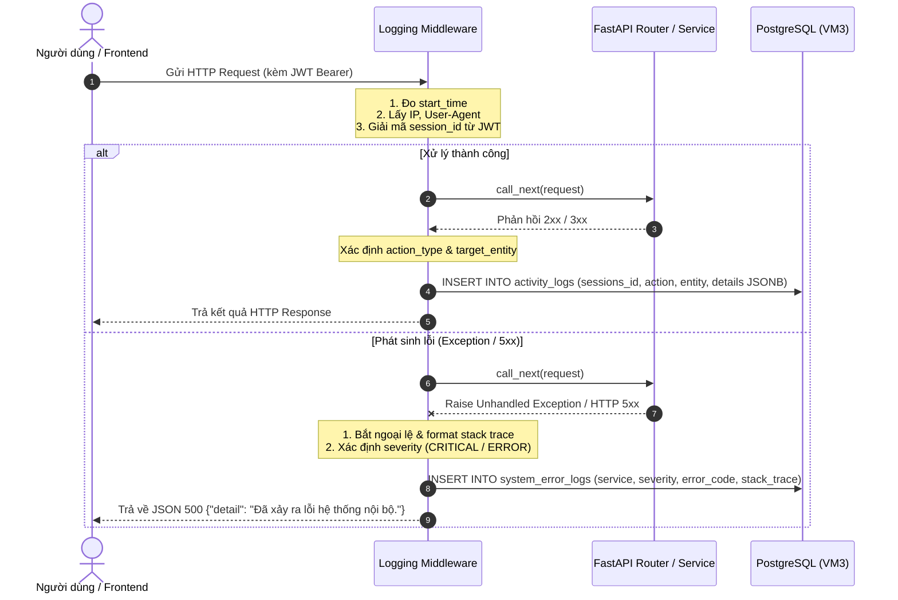

# TÀI LIỆU MIDDLEWARE: GHI NHẬN HÀNH VI & LỖI HỆ THỐNG (CVIEW)

Tài liệu mô tả ngắn gọn về vai trò, nhiệm vụ, kiến trúc, luồng hoạt động và cách kiểm thử của tầng Middleware tại thư mục `backend/app/middlewares`.

---

## 1. Vai trò (Role)
Middleware đóng vai trò là **lớp chắn và bộ giám sát trung gian** (Interception & Observability Layer) nằm giữa Client và toàn bộ hệ thống API Backend:
* **Kiểm toán hành vi (Audit Trail):** Tự động ghi nhận mọi thao tác nghiệp vụ quan trọng của người dùng có phiên hợp lệ vào bảng `activity_logs`.
* **Giám sát sự cố (Error Tracking):** Bắt trọn toàn bộ ngoại lệ chưa được xử lý (Unhandled Exceptions) và lỗi HTTP 5xx, tự động lưu vết sự cố chi tiết vào bảng `system_error_logs`.
* **Bảo vệ ứng dụng (Fail-safe):** Đảm bảo hoạt động ghi log chạy trong giao dịch độc lập, tuyệt đối không làm sập hoặc ảnh hưởng đến luồng trả kết quả cho người dùng.

---

## 2. Nhiệm vụ chính (Responsibilities)
1. **Giải mã phiên làm việc (`sessions_id`):** Tự động trích xuất `session_id` chuẩn UUID từ Access Token JWT (`Authorization: Bearer <token>`) hoặc `X-Session-ID`.
2. **Ghi nhật ký nghiệp vụ (`activity_logs` - Bảng 8):**
   * Lưu các thao tác thành công (`200 <= status < 400`).
   * Tuân thủ 100% ràng buộc `CHECK` CSDL:
     * `action_type`: `'UPLOAD_RESUME'`, `'ANALYZE_CV'`, `'VIEW_JOB'`, `'SEARCH_JOB'`, `'SAVE_JOB'`, `'APPLY_JOB'`, `'CREATE_JOB_POST'`, `'APPROVE_JOB_POST'`, `'REJECT_JOB_POST'`.
     * `target_entity`: `'RESUME'`, `'JOB_POST'`, `'CV_ANALYSIS'`, `'ACCOUNT'`, `'APPLICATION'`.
   * Ghi nhận `details` dạng JSONB: IP, User-Agent, đường dẫn, HTTP method, status code, query params, và thời gian phản hồi (`duration_ms`).
3. **Ghi nhật ký sự cố (`system_error_logs` - Bảng 9):**
   * Bắt các lỗi nghiêm trọng (`ValueError`, `OperationalError`, lỗi CSDL, lỗi logic).
   * Phân loại mức độ: `CRITICAL` (lỗi CSDL/hạ tầng) hoặc `ERROR` (ngoại lệ logic).
   * Lưu trữ `error_code`, `message`, `stack_trace` đầy đủ của Python để phục vụ bảo trì.
   * Định dạng phản hồi an toàn: Trả về JSON chuẩn `500 Internal Server Error`, giấu stack trace nhạy cảm đối với người dùng cuối.

---

## 3. Kiến trúc mã nguồn (Architecture)

Thư mục `backend/app/middlewares/` được tách thành các module gọn nhẹ ($< 300$ dòng code/file):

```text
backend/app/middlewares/
├── __init__.py             # Public API: export middleware, helpers, constants
├── logger_utils.py         # Danh mục CHECK, hàm ghi log trực tiếp, hàm suy luận route
└── logging_middleware.py   # Lớp Middleware chính (kế thừa BaseHTTPMiddleware)
```

### Sơ đồ tương tác



---

## 4. Cách thức hoạt động (Workflow)

1. **Khách vãng lai (Chưa đăng nhập):**
   * Các request tìm kiếm hoặc xem trang chủ không có token sẽ được bỏ qua việc ghi `activity_logs` để tránh vi phạm ràng buộc khóa ngoại `sessions_id NOT NULL REFERENCES sessions(session_id)`.
2. **Người dùng đã đăng nhập:**
   * Khi gửi kèm Header `Authorization: Bearer <access_token>`, middleware tự động giải mã `session_id` được gắn sẵn trong token khi đăng nhập.
   * Middleware tự động nhận diện hành động qua URL:
     * `GET /api/v1/jobs/search` $\rightarrow$ `action_type = 'SEARCH_JOB'`, `target_entity = 'JOB_POST'`
     * `GET /api/v1/jobs/{id}` $\rightarrow$ `action_type = 'VIEW_JOB'`, `target_id = {id}`
     * `POST /api/v1/jobs` $\rightarrow$ `action_type = 'CREATE_JOB_POST'`
     * `POST /api/v1/jobs/{id}/save` $\rightarrow$ `action_type = 'SAVE_JOB'`
     * `POST /api/v1/jobs/{id}/apply` $\rightarrow$ `action_type = 'APPLY_JOB'`, `target_entity = 'APPLICATION'`
     * `POST /api/v1/resumes/upload` $\rightarrow$ `action_type = 'UPLOAD_RESUME'`, `target_entity = 'RESUME'`
     * `POST /api/v1/resumes/analyze` $\rightarrow$ `action_type = 'ANALYZE_CV'`, `target_entity = 'CV_ANALYSIS'`
3. **Cơ chế Xác thực Không Bắt Buộc (Optional Authentication):**
   * Các API công khai như tìm kiếm việc (`/jobs/search`) hay xem chi tiết việc (`/jobs/{id}`) được gắn `dependencies=[Depends(bearer_scheme)]` với `auto_error=False`.
   * **Nghiệp vụ:** Khách vãng lai không có token vẫn truy cập bình thường (HTTP 200).
   * **Swagger UI & Frontend Interceptor:** Tự động gửi kèm token nếu người dùng đã đăng nhập, giúp Middleware định danh được người dùng và ghi log kiểm toán.
4. **Tùy biến qua Code:**
   * Các endpoint có thể chủ động chỉ định hành vi kiểm toán thông qua helper `set_activity_log(...)` (ví dụ: phân biệt duyệt tin `APPROVE_JOB_POST` và từ chối `REJECT_JOB_POST`) hoặc dùng decorator `@record_activity(...)`.

---

## 5. Hướng dẫn kiểm thử (Testing)

### 5.1. Chạy tự động toàn bộ test suite (Pytest)
Hệ thống kiểm thử được thiết lập trong môi trường conda **`cview`** với **14 test cases**:
* `backend/tests/test_logging_utils.py`: Kiểm tra danh mục CHECK CSDL, ghi log trực tiếp, lọc UUID.
* `backend/tests/test_logging_middleware.py`: Kiểm tra Middleware tự động bắt ngoại lệ, trích xuất token, và kiểm toán hành vi.

Lệnh thực hiện:
```bash
conda activate cview
PYTHONPATH=backend pytest backend/tests/ -v
```

---

### 5.2. Kiểm thử tương tác qua Swagger UI (`/docs`)

Swagger UI cho phép kiểm tra trực quan toàn bộ hoạt động của Middleware mà không cần đợi hoàn thiện giao diện Frontend:

1. **Khởi động Backend:**
   ```bash
   conda activate cview
   cd backend
   uvicorn app.main:app --reload
   ```
2. **Mở trình duyệt:** Truy cập `http://localhost:8000/docs`.
3. **Đăng nhập lấy Access Token:**
   * Chọn `POST /api/v1/auth/candidate/login` $\rightarrow$ bấm **Try it out**.
   * Nhập tài khoản demo:
     ```json
     {
       "username_or_email": "candidate01",
       "password": "Password@123"
     }
     ```
   * Bấm **Execute** $\rightarrow$ Copy chuỗi `access_token` từ kết quả JSON trả về.
4. **Ủy quyền (Authorize) trên Swagger UI:**
   * Cuộn lên đầu trang, bấm vào nút **Authorize** (biểu tượng ổ khóa màu xanh lá).
   * Dán mã token vào ô **Value** $\rightarrow$ bấm **Authorize** $\rightarrow$ bấm **Close**.
5. **Thao tác thử nghiệm các hành vi nghiệp vụ:**
   * **Tìm kiếm việc:** Chọn `GET /api/v1/jobs/search` $\rightarrow$ nhập `keyword = React`, `city = Hanoi` $\rightarrow$ bấm **Execute**.
   * **Xem chi tiết tin:** Chọn `GET /api/v1/jobs/{job_id}` $\rightarrow$ nhập `job_id = job-demo-99` $\rightarrow$ bấm **Execute**.
   * **Tải lên CV:** Chọn `POST /api/v1/resumes/upload` $\rightarrow$ bấm **Execute**.
   * **Phân tích CV:** Chọn `POST /api/v1/resumes/analyze` $\rightarrow$ bấm **Execute**.

---

### 5.3. Kiểm tra dữ liệu ghi nhận trong CSDL PostgreSQL

Sau khi thực hiện các thao tác trên Swagger UI, kiểm tra trực tiếp các bản ghi đã được Middleware lưu lại:

#### Cách A: Chạy Script Python kiểm tra nhanh (Khuyên dùng)
```bash
conda activate cview
PYTHONPATH=backend python -c "
import json
from app.core.database import SessionLocal
from app.models.system import ActivityLog, SessionRecord, Account
from sqlalchemy import desc

with SessionLocal() as db:
    logs = db.query(ActivityLog, SessionRecord, Account)\
             .join(SessionRecord, ActivityLog.sessions_id == SessionRecord.session_id)\
             .join(Account, SessionRecord.account_id == Account.account_id)\
             .filter(Account.username == 'candidate01')\
             .order_by(desc(ActivityLog.activity_id))\
             .limit(5).all()

    print('=' * 80)
    print(' NHẬT KÝ HOẠT ĐỘNG CỦA CANDIDATE01 VỪA GHI NHẬN TỪ SWAGGER UI:')
    print('=' * 80)
    for act, sess, acc in logs:
        print(f'📌 [Activity #{act.activity_id}] Thao tác: {act.action_type} | Thực thể: {act.target_entity} (ID: {act.target_id})')
        print(f'   • Session ID : {act.sessions_id}')
        print(f'   • Thời điểm  : {act.created_at}')
        print(f'   • Chi tiết   : {json.dumps(act.details, indent=4, ensure_ascii=False)}')
        print('-' * 80)
"
```

#### Cách B: Truy vấn trực tiếp bằng SQL trong Docker Container
```bash
docker exec -it cview-postgres psql -U cview_user -d cview_db -c "
SELECT 
    a.activity_id,
    acc.username,
    a.action_type,
    a.target_entity,
    a.target_id,
    a.details->>'path' AS endpoint,
    a.details->>'status_code' AS status,
    a.created_at
FROM activity_logs a
JOIN sessions s ON a.sessions_id = s.session_id
JOIN accounts acc ON s.account_id = acc.account_id
WHERE acc.username = 'candidate01'
ORDER BY a.activity_id DESC
LIMIT 5;
"
```
